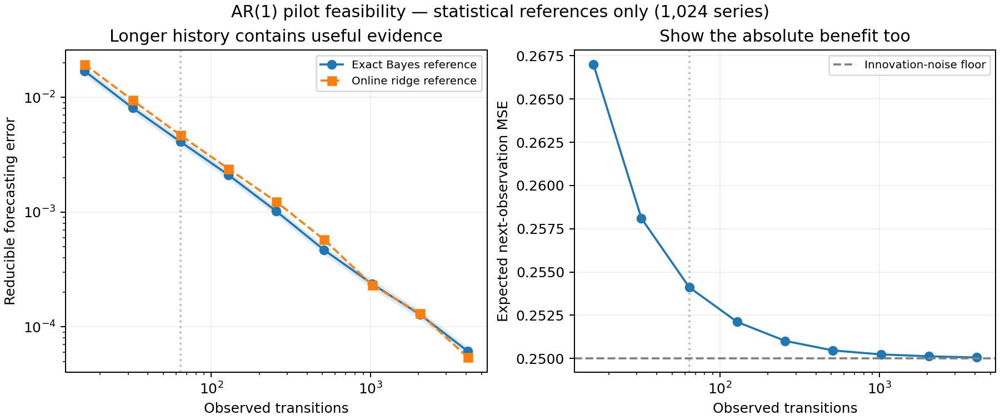

# Streaming forecasting: experiment plan

**Status:** The initial pilot, three-seed follow-up, and longer-history sweep are complete. See the [latest results](../results/2026-11-23-forecast-horizon/README.md) and [registered sweep plan](forecast_horizon.md). All apps are stopped; the confirmation set remains unopened. The protocol below describes the initial pilot.

> **Can a recurrent forecaster trained on short sequences keep improving its predictions as a much longer series arrives, using fixed memory and no weight updates?**

The practical issue is whether keeping a recurrent model's state alive lets it accumulate useful knowledge about a particular series. We want to measure how much forecast accuracy it gains from additional observations, and whether its training sequence length limits those gains.

## 1. Start with a process whose best possible forecast we can calculate

For each independent series, draw a coefficient $a$ and generate

$$
y_{t+1}=a\,y_t+\epsilon_{t+1},
\qquad a\sim\operatorname{Uniform}[-0.95,0.95],
\qquad \epsilon_t\sim\mathcal N(0,0.5^2).
$$

Set $y_0=0$. The coefficient stays fixed within a series and changes between series. A positive coefficient makes adjacent observations tend to move together; a negative coefficient makes them tend to alternate signs. The model sees observations, but never receives the coefficient.

The latest observation tells us the current value. A longer history helps estimate **how this particular series behaves**, which improves its next forecast. We always predict one step ahead in this first pilot; the amount of observed history grows.

Each input token contains the two observed values $(y_{t-1},y_t)$ and asks for a prediction of $y_{t+1}$. Both architectures receive the same lag feature. This makes the statistical estimation problem explicit and avoids making the comparison depend on recovering adjacency from positional embeddings. No future values or true parameters enter the model inputs.

This is a deliberately simple control. It establishes that the experiment and learned estimation work before we move to a richer forecasting setting.

## 2. Train two architectures under two history-length regimes

We train small models from scratch on many independent series. During training, weights are updated normally. During evaluation on new series, weights stay frozen; adaptation can happen only through the input history and recurrent state. That is the ICL component.

| Training regime | Gated DeltaNet | Causal Transformer control |
|---|---|---|
| **Short histories** | Always 64 observed transitions | Always 64 observed transitions |
| **Mixed histories** | Alternate 64 and 256 transitions | Alternate 64 and 256 transitions |

These are **four initial research runs**, starting with one training seed. The short-versus-mixed comparison is the main intervention: it tests whether exposure to longer histories improves continued learning **without increasing the recurrent state**. The Transformer helps establish whether any effect also appears outside recurrent models.

Resolved settings used for the first four runs:

| Setting | Value |
|---|---|
| Model size | 2 layers, width 64, 4 heads |
| Parameters | GDN: 110,641; Transformer: 99,841 |
| GDN persistent state | 12,800 bytes per series in FP32, plus the latest raw scalar |
| GDN implementation | Gated delta recurrence, causal convolution of size 4, exact chunks of 64 |
| Transformer positions | No positional embeddings; explicit lag pairs supplied to both models |
| Optimizer | Adam, learning rate $3\times10^{-4}$, betas $(0.9,0.999)$, epsilon $10^{-8}$ |
| Regularization | No weight decay; gradient norm clipped to 1 |
| Initial training budget | 2,000 optimizer updates per run |
| Predictions used per update | 2,048: batch 32 at length 64, batch 8 at length 256 |
| Total training prediction positions | 4,096,000 per run |
| Initial seed | 182 initially; the linked follow-up also completed seeds 183 and 184 |
| Precision | FP32; no autocast or TF32 |

The regimes match prediction-token and optimizer-update budgets. They do **not** match distinct-series counts or FLOPs: short training sees 64,000 series and mixed training sees 40,000. The architectures are also not exactly parameter matched. We will report these differences and avoid interpreting this as a definitive architecture ranking.

The nominal 2,000-step budget is a starting point. If a model has not learned the task at its training length, its long-history results cannot establish a memory limitation. Training and validation curves determine whether additional optimization is needed before interpretation.

## 3. Freeze the weights and let a new series get longer

On each held-out series, evaluate the same model after these numbers of observed transitions:

**16 → 32 → 64 → 128 → 256 → 512 → 1,024 → 2,048 → 4,096.**

- **GDN:** carry the same recurrent state forward as observations arrive. Transfer only the current chunk to the model device. Reset state between independent series.
- **Transformer:** provide the entire observed prefix at each evaluation point. No rolling-window truncation is used.
- **Both:** keep weights frozen and score only forecasts made from observations available at that time.

Thus a model trained on sequences of length 64 is tested after up to 4,096 observations. We measure whether its predictions benefit from that additional evidence.

The GDN state count excludes weights and temporary chunk activations. The Transformer requires its input history and attention intermediates; its lack of a recurrent-state buffer does not imply zero memory use. The current implementations validate forecasting behavior and state handling, rather than production-kernel throughput.

## 4. Compare against statistical references

The **Bayesian reference** knows the distribution used to generate series, but does not know the actual coefficient of the new series. It uses the observed history to compute the best mean-squared-error forecast under that distribution.

The reference only needs two running sums:

$$
S_{xx}=\sum_{s=1}^{t} y_{s-1}^2,
\qquad S_{xy}=\sum_{s=1}^{t}y_{s-1}y_s.
$$

For $S_{xx}>0$, the posterior of $a$ is a normal distribution with mean parameter $S_{xy}/S_{xx}$ and variance parameter $0.5^2/S_{xx}$, truncated to $[-0.95,0.95]$. At $S_{xx}=0$, it remains the uniform prior. The posterior moments are computed in float64 and checked against independent numerical integration.

Its prediction is

$$
\hat y^{\mathrm{Bayes}}_{t+1}=y_t\,\mathbb E[a\mid y_{0:t}],
$$

with conditional prediction risk

$$
0.5^2+y_t^2\operatorname{Var}(a\mid y_{0:t}).
$$

A separate **online ridge estimator** uses the same sums with a Gaussian prior matched to the uniform prior's variance. It is a classical baseline, not the exact Bayesian reference for the bounded prior.

This matters because compact memory is sufficient for this task. If the neural forecaster stops improving while these references improve, we can investigate its learned update rule or training procedure without assuming that raw-history storage is mathematically necessary.

## 5. The figures we want

The main plot has **observed history length** on the horizontal axis and **forecast error** on the vertical axis, with lines for the two training regimes, two architectures, and statistical references.

We report three complementary quantities:

| Quantity | What it answers |
|---|---|
| Squared error relative to the true conditional mean $a y_t$ | How much reducible forecasting error remains? We know $a$ for measurement because the series are synthetic; it is never supplied to the model. |
| Squared disagreement with the Bayesian prediction | How well does the model approximate the best forecast available from this history? |
| Total expected predictive MSE | How large is the benefit in ordinary forecasting error, including unavoidable noise? |

Total expected predictive MSE equals the first quantity plus the innovation variance, $0.25$. We also save realized-target MSE and Bayes-risk-normalized excess for continuity with the previous pilot.

Validation uses 512 fixed series with seed 920000000. The initial reference-only feasibility figure uses 1,024 validation series, explicitly labeled. A separate 1,024-series confirmation set, seed 940000000, stays unopened until the training protocol and checkpoint selection are frozen.

Series-level error bars describe uncertainty across independent series. Once we replicate training, we separately report variation across training seeds.

## 6. What different outcomes would mean

| Observation | Supported interpretation |
|---|---|
| Short-trained GDN continues improving along with the reference | Short-sequence training can produce useful continued estimation over the tested range. |
| Short-trained GDN stalls; mixed-length training extends improvement | Training history length is an actionable constraint in this setup, with the same recurrent state size. |
| Both architectures show the same pattern | The effect may be a more general training-length problem. |
| GDN stalls while the Transformer and compact statistical reference improve | Investigate recurrent training, learned updates, and capacity; this alone does not prove an architectural impossibility. |
| A model is already weak at length 64 | Resolve optimization or model suitability before interpreting extrapolation. |
| The Bayesian reference itself shows little remaining improvement | Longer history has little available value in that setting. |

The useful contribution is a controlled account of **when additional observations produce additional forecast accuracy, and whether training changes that relationship**. Finite-length results do not prove asymptotic statistical consistency.

## 7. A limitation already visible in the reference calculation

At 64 observations, the estimated mean exact Bayes risk is **0.254115**. At 4,096 it is **0.250061**, against an innovation-noise floor of **0.25**.

The reducible uncertainty drops roughly **67-fold**, but total ideal forecast MSE improves only about **1.6%**. We will show both quantities. One-step AR(1) is a useful control, and by itself cannot support a claim of large practical forecasting gains.



After this control, the next substantive setting should have enough remaining forecasting uncertainty for longer history to matter in absolute error. Candidates are a richer dynamical process or multi-step forecasting; the final choice is still open. We should first verify its available benefit using a statistical reference, then freeze the experimental protocol before evaluating confirmation data. A claim about deployed foundation models additionally needs a pretrained-model or real-data check.

## 8. Completed pilot and next decision

Local CPU checks and the personal Modal GPU preflight passed, including causality and agreement between carried-state and full-sequence predictions. All four research runs completed 2,000 updates; validation predictions were saved at 500, 1,000, and 2,000. All five apps are stopped with zero tasks.

The [results report](../results/2026-11-23-forecast-ar1/README.md) shows a substantial long-history degradation for short-trained GDN, mitigated by mixed-length training with the same state size. Mixed GDN still plateaus after roughly 128–256 observations. Transformer errors improve from 64 to 4,096 under both regimes. These are exploratory results from one training seed, and checkpoint curves have not settled.

The [completed follow-up](../results/2026-11-23-forecast-ar1-10k/README.md) extends these conditions to 10,000 updates and three seeds. Mixed training improves GDN long-history error in all three seeds, but variability is large and longer training does not reliably resolve degradation. The subsequent [training-history sweep](../results/2026-11-23-forecast-horizon/README.md) also completed. Uninterrupted 2,048-length training beats its matched reset control across all three seeds, while long-history errors largely plateau above the Bayesian reference. Confirmation and richer-task evaluations remain unopened.

The [resolved run configurations](../results/2026-11-23-forecast-ar1/configs/) contain the exact training settings. The [GPU preflight record](../results/2026-11-23-forecast-ar1/gpu_preflight.json) contains correctness checks and timing. The earlier [preparation configuration](../results/2026-11-23-forecast-preparation/resolved_preflight.json) remains as a historical preparation artifact.

## Personal resources only

The following were checked on 2026-11-23:

| Resource | Destination / finding |
|---|---|
| GitHub authenticated identity | `Alex2262`, verified against GitHub |
| Git remote | `https://github.com/Alex2262/project182.git` |
| Commit identity | `81930082+Alex2262@users.noreply.github.com` |
| Modal | Named profile verified to belong to workspace `alexander-tian` |
| Modal app inventory | All initial, follow-up, and horizon-sweep apps verified stopped with zero tasks |
| Storage target | `project182-artifacts` in that personal Modal workspace |
| Logging target | Live logs verified identity `alexander-tian` and destination `alexander-tian-ucb/project182`, using personal secret `project182-wandb` |
| Cloud code upload | Three forecasting modules and their YAML config explicitly uploaded; Modal also uploads the forecasting launcher |
| Compute so far for this pilot | Local checks and approved personal A100 preflights, training runs, and frozen-checkpoint evaluations |

No MatX cluster, repository, storage, or logging project has been used for this pilot. The launcher rejects a different Modal profile and credential/config environment overrides before defining remote resources. It also rejects a different W&B destination. All initial and follow-up live job logs confirmed the personal W&B identity and project. No MatX resource was used during preparation or training.

## Reproduction

From the repository root, with `requirements-forecast.txt` installed in a local Python environment:

```bash
python scripts/check_forecast.py --output outputs/forecast_reference --series 1024
python src/forecast_runtime.py dry-run
python src/forecast_runtime.py preflight --device cpu --output outputs/cpu_preflight
```

After explicit GPU approval:

```bash
MODAL_PROFILE=alexander-tian .venv-modal/bin/modal run scripts/modal_forecast.py \
  --action preflight \
  --resolved-file results/2026-11-23-forecast-preparation/resolved_preflight.json
```

## Literature boundaries

- [Why Do Time Series Models Need Long Context Windows?](https://arxiv.org/abs/2606.01999): long history can help identify unknown dynamics.
- [A Unified Scaling Law for Time Series Foundation Models](https://arxiv.org/abs/2610.05269): context scaling and rule identification are already studied.
- [TiRex-2](https://arxiv.org/abs/2607.01204): recurrent time-series foundation models support long streaming inference.
- [TempoPFN](https://arxiv.org/abs/2510.25502): linear recurrent synthetic pretraining is already a viable forecasting approach.
- [From Markov to Laplace](https://arxiv.org/abs/2502.10178): Mamba can learn a statistical estimator in context.

Our investigation builds on these findings. It should focus its contribution on training length versus continued evidence use, and on a tested intervention, rather than claim the established findings as new.
