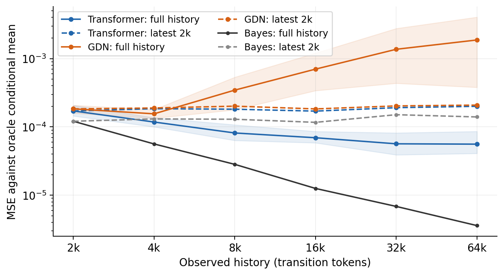
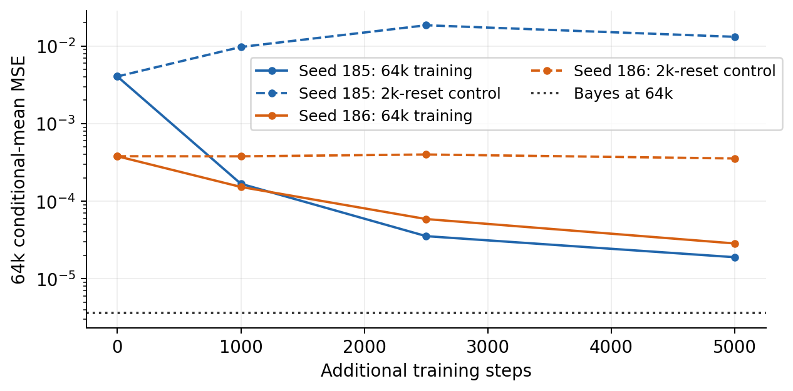
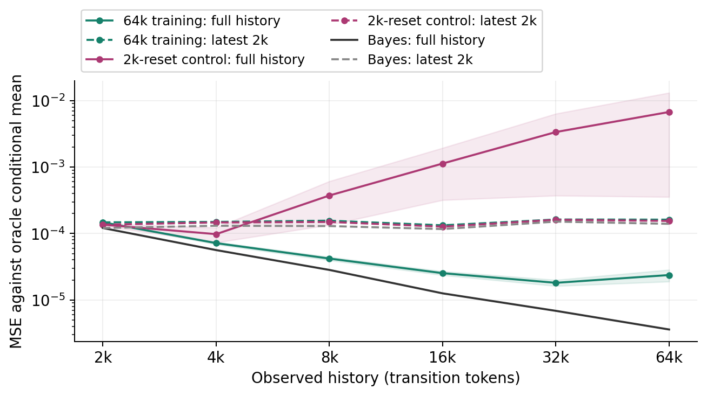
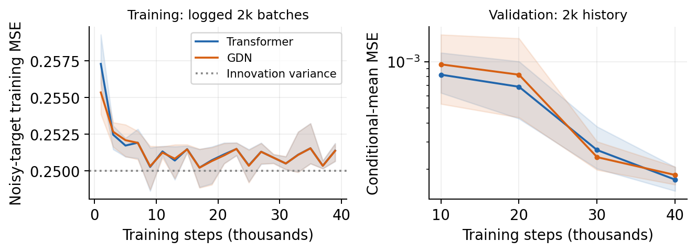

# V1 figures and reproduction

These figures support the completed 4-layer, width-256 forecasting experiments: 40k-step base training, fresh-state latest-2k replay, and paired 5k-step long-context versus reset-control continuation. The manuscript and Overleaf source are maintained separately.

## Figures

### History beyond the training length



[Vector PDF](figures/history_40k.pdf). Three seeds per architecture, peak learning rate 1e-4; full history versus latest-2k replay at the same query.

### Paired continuation



[Vector PDF](figures/adaptation_paired.pdf). Each pair starts from the same 40k GDN checkpoint and Adam state. Both arms receive the same new observations, targets, optimizer steps, and learning-rate schedule. Seeds 185 and 186 are shown individually.

### History use after continuation



[Vector PDF](figures/adaptation_history.pdf). Means over the two paired continuation seeds; shading spans the observed seed results.

### Base training and validation



[Vector PDF](figures/learning_curves.pdf). Three seeds per architecture at peak learning rate 1e-4. Training MSE includes observation noise; validation measures error against the oracle conditional mean.

## Reproduce all four figures

From the repository root:

```bash
python -m pip install -r report/v1/requirements-figures.txt
python report/v1/reproduce_figures.py
```

The script reads committed predictions, Bayesian references, and training logs. It needs no GPU, cloud credentials, checkpoints, or ignored `outputs/` directory. It writes PDF and PNG versions into `report/v1/figures/`.

## Experiment records

- [40k base sweep](../../results/2026-11-24-reference4x256-40k/): twelve runs, two learning rates, three seeds per architecture, through 64k evaluation history.
- [Continuation and follow-up experiments](../../results/2026-11-24-long-context-adaptation/): paired long/reset continuations, fresh 80k baselines, and layer-reset ablations. The four figures above use only the base sweep and paired continuations.

Raw evidence was released in commit `26dcc53948747bef9332fa8f814e6ed046ae4edf`. The result directories include manifests, resolved configurations, source snapshots, predictions, references, and verification records.

## Interpretation

- The main metric is MSE against the oracle conditional mean `a*y_t`. Expected noisy-target MSE adds the innovation variance 0.25.
- All evaluation policies use the same 512 validation series. This cohort was repeatedly inspected during development.
- Shading shows minimum to maximum across training seeds, not a confidence interval.
- Each continuation arm adds 327.68M prediction positions, doubling the base training data.
- Long-context continuation changes both available history and gradient span. Their effects have not been isolated.
- Evaluation at 64k after training at 64k establishes adaptation at that length, not extrapolation beyond it.
- Both architectures use reference implementations; depth and width match, parameter counts and compute differ. Versions are PyTorch 2.10.0+cu128, Transformers 5.6.2, fla-core 0.6.0, and Triton 3.7.1.
