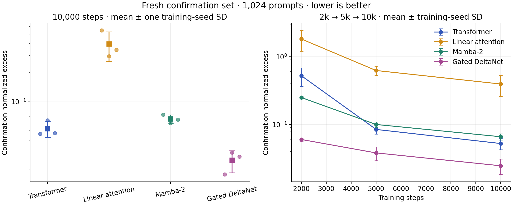
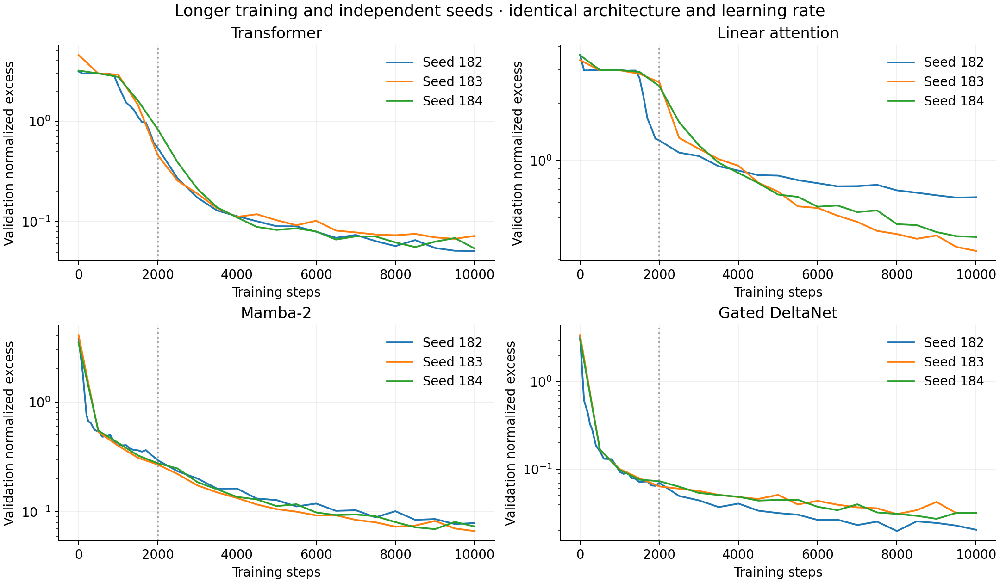
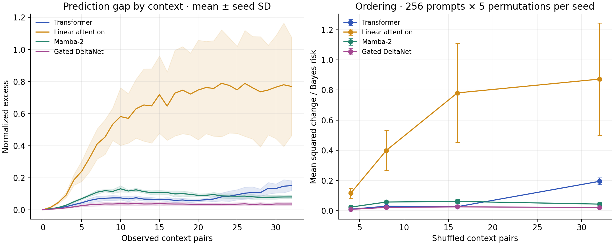
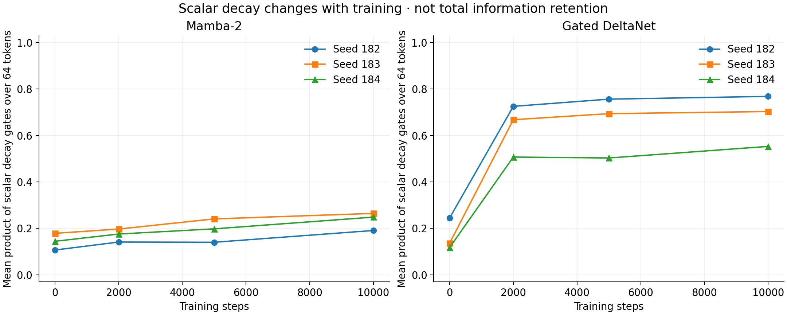
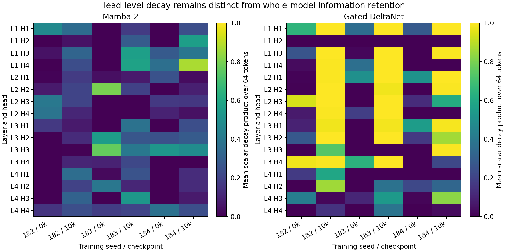

# Noisy linear regression: longer runs and three seeds

Completed November 20, 2026. Four architectures, three independent training seeds each, 10,000 updates per run. This is the low-dimensional control experiment for our in-context learning project.

## Main results

Normalized excess error measures squared disagreement with the exact Bayesian posterior mean, divided by mean Bayes risk for noisy labels. **Lower is better; zero matches the Bayes predictor.** Every checkpoint uses the same fresh 1,024 test prompts. Values are means across three training seeds; ± is the sample standard deviation across those seeds, not a confidence interval.

| Architecture | 2,000 updates | 5,000 updates | 10,000 updates |
| --- | ---: | ---: | ---: |
| Transformer (GPT-2) | 0.5237 ± 0.1587 | 0.0849 ± 0.0123 | 0.0527 ± 0.0100 |
| Linear attention | 1.8155 ± 0.6194 | 0.6246 ± 0.0963 | 0.3953 ± 0.1339 |
| Mamba-2 | 0.2500 ± 0.0101 | 0.1004 ± 0.0093 | 0.0663 ± 0.0069 |
| Gated DeltaNet | 0.0604 ± 0.0031 | 0.0383 ± 0.0087 | 0.0248 ± 0.0063 |

## What we can discuss

- Longer training substantially changes the comparison: the Transformer's mean error drops about tenfold from 2k to 10k updates.
- Gated DeltaNet has the lowest final error in all three seeds.
- Transformer and Mamba-2 are close overall. The paired three-seed 95% interval for their difference includes zero, so this does not establish a reliable winner between them.
- At 32 context examples, Mamba-2 has about 4.5 times lower normalized shuffle sensitivity than the Transformer (0.0435 versus 0.1945). Gated DeltaNet is lowest at 0.0211; linear attention is 0.8723.
- Some validation curves are still improving. These are results at a common training budget, not proof of convergence or a memory-capacity limit.

## Learning curves

Validation uses a separate fixed set of 256 prompts. Each line is an independent training seed.

## Context length and order sensitivity

The order test shuffles the observed context pairs while holding the query fixed: 256 prompts, five permutations each, at 4, 8, 16, and 32 context examples. The exact Bayesian predictor is order-invariant. Smaller prediction changes mean less sensitivity to arbitrary example ordering.

## Decay gates

These diagnostics use fixed validation prompts. The product of decay gates is a diagnostic of the scalar decay path, not total information retention. Writes, convolutions, and other layers also matter. Gate averages alone do not establish a causal explanation.

## Setup and limitations

Noisy linear regression with d=5, weights drawn from N(0,I), inputs uniform on [-1,1]^5, and Gaussian noise standard deviation 0.5. Each prompt has 33 x/y pairs, giving predictions with 0–32 previous examples. All models use four layers, width 128, four heads, batch size 64, Adam at learning rate 0.0003, and FP32 with TF32 disabled.

Training seeds are 182, 183, and 184; each varies both initialization and training data. Models within a seed receive identical training prompts. Seed 182 continued from the initial pilot. The 10k horizon was chosen using its validation curves, then fixed before training the two additional seeds. Confirmation seed 300000000 was evaluated after all training decisions were fixed. Bayesian reference calculations use float64.

Parameter counts and architecture details are not exactly matched. Mamba-2 uses a PyTorch fallback; Gated DeltaNet uses an exact PyTorch triangular-solve recurrence; linear attention uses a quadratic causal implementation. Runtime is not an optimized-kernel speed comparison. Three seeds give limited statistical precision. We have not yet tested GP difficulty, state-size ablations, ordered-time tasks, or prior mismatch.

## Files and logs

- [Meeting notes](meeting_notes.txt): detailed findings, protocol, gate interpretation, and recorded compute costs.
- [Results CSV](results.csv): all 36 architecture/seed/checkpoint combinations, with run links.
- [Detailed results JSON](results.json): aggregate statistics, paired differences, histories, gate summaries, and experiment metadata.
- [W&B dashboard](https://forge.coreweave.com/wandb/alexander-tian-ucb/project182): training logs (access depends on W&B permissions).

Figures and tables can be viewed directly here without a W&B account. Large checkpoints remain in the personal Modal volume; this folder contains the shareable report rather than model binaries.
