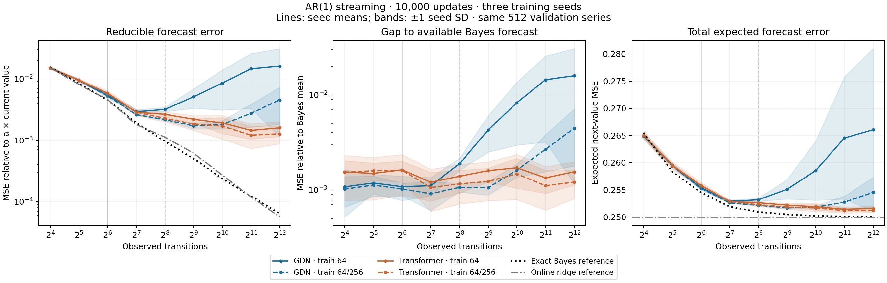
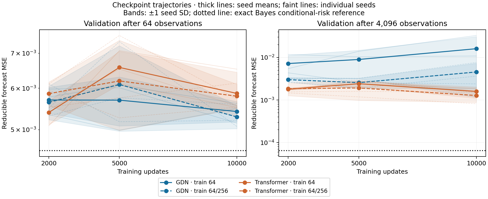

# Streaming AR(1): 10,000 updates across three training seeds

**Follow-up available:** [training-history sweep and matched reset control through 16k observations](../2026-11-23-forecast-horizon/README.md). The report below preserves the earlier results.

**November 23, 2026 · 12/12 runs completed · All apps stopped · Exploratory validation**

**The training-length intervention helps GDN across all three tested seeds, but its benefit varies substantially and continued improvement with history is not restored.** At 4,096 observations, mixing lengths 64 and 256 reduces GDN's seed-mean reducible error by **71.6%**, using the same recurrent state. Individual-seed reductions range from **18.8% to 77.9%**. Both Transformer training regimes benefit from longer history in every seed.



Lines average the errors of three separately trained models; they are not ensemble predictions. Bands show **±1 sample standard deviation across training seeds**, not confidence intervals. All models use the same 512 validation series. The exact Bayes line averages conditional posterior risk over those histories. Gray vertical markers denote training lengths 64 and 256.

## Final results

Reducible error is squared error relative to the true next-value mean, $a y_t$. The hidden coefficient is available only for scoring. Adding innovation variance **0.25** gives total expected next-value MSE. Lower is better.

| Model and training history | Reducible error at 64 | Reducible error at 4,096 | Total expected MSE at 4,096 |
|---|---:|---:|---:|
| GDN · 64 | 0.005416 ± 0.000242 | **0.016062 ± 0.014905** | 0.266062 |
| GDN · 64/256 | 0.005288 ± 0.000267 | **0.004559 ± 0.002742** | 0.254559 |
| Transformer · 64 | 0.005865 ± 0.000574 | 0.001592 ± 0.000439 | 0.251592 |
| Transformer · 64/256 | 0.005794 ± 0.000314 | 0.001276 ± 0.000396 | 0.251276 |
| Exact Bayes conditional-risk reference | 0.004557 | 0.0000644 | 0.250064 |

Values before ± are means across seeds; ± is seed standard deviation. The reference has no training seed. Mixed training lowers GDN's total expected MSE by **4.3%** at 4,096. Its 71.6% reducible-error improvement is a ratio of seed-mean errors, not the average of individual percentage improvements. The corresponding Transformer reductions are 19.9% in reducible error and 0.13% in total MSE.

The individual long-history errors matter because GDN's variability is large:

| Training seed | GDN short | GDN mixed | GDN reduction from mixing | Transformer short | Transformer mixed |
|---|---:|---:|---:|---:|---:|
| 182 | 0.010827 | 0.002396 | 77.9% | 0.001793 | 0.001520 |
| 183 | 0.004480 | 0.003640 | 18.8% | 0.001089 | 0.000819 |
| 184 | 0.032878 | 0.007643 | 76.8% | 0.001894 | 0.001488 |

All three short-trained GDNs worsen between 256 and 4,096 observations. Compared with 64 observations, two worsen and one improves. Thus the original single-seed statement that longer history roughly doubles GDN's error does **not** describe every seed. The broader replicated pattern is degradation after an intermediate history length, with partial mitigation from mixed training. Mixed GDN's mean error reaches its minimum around 512 observations and then rises.

## Does training longer resolve it?



| Training updates | GDN short, error at 4,096 | GDN mixed | Transformer short | Transformer mixed |
|---|---:|---:|---:|---:|
| 2,000 | 0.007197 | 0.003005 | 0.001792 | 0.001850 |
| 5,000 | 0.008964 | 0.002559 | 0.002414 | 0.001919 |
| 10,000 | 0.016062 | 0.004559 | 0.001592 | 0.001276 |

These are seed means. More optimization does not reliably resolve the extrapolation problem. The increase in short-trained GDN's mean is strongly influenced by seed 184; the other seeds do not show the same training trajectory. The curves are also non-monotonic for other conditions. We have reached a fixed experimental endpoint, not established convergence.

The primary endpoint was fixed at 10,000 updates before launch. We report 2k and 5k as exploratory trajectories and have not chosen a better-looking checkpoint. The separate confirmation set remains **unopened**.

## What we can tell the team

> In a controlled forecasting problem where constant-memory sufficient statistics are enough, GDN's short-history training performance does not reliably predict its ability to use a long deployment stream. Extending training to 10k updates does not reliably remove the degradation. Exposing the same model to somewhat longer training sequences reduces long-history error across three seeds, but still falls well short of continued Bayesian improvement. The Transformer control uses additional history more reliably in this setup.

This supports training-history length as an actionable factor in learned streaming estimation. It does not identify a causal gate mechanism, prove that recurrent models lack capacity, establish asymptotic behavior, or characterize time-series foundation models generally. The models differ in parameter count, the optimizer is fixed, and only three seeds were tested.

One-step AR(1) remains a controlled test with limited practical forecasting benefit: the exact reference can improve total MSE only about 1.8% from 64 to 4,096 on these histories. A richer task is needed for a strong claim about useful forecasting gains. No additional training-length sweep, capacity change, richer-task run, or confirmation evaluation has been launched.

## Experiment and preservation details

The data follow $y_{t+1}=a y_t+\epsilon_{t+1}$ with a new $a\sim\mathrm{Uniform}[-0.95,0.95]$ for each series, Gaussian innovation standard deviation 0.5, and $y_0=0$. Both models receive observed lag pairs. Weights stay frozen during evaluation. GDN carries state through the stream; Transformer receives the entire observed prefix. Statistical references know the coefficient prior but not the particular series' coefficient.

| Setting | Value |
|---|---|
| Conditions | GDN / Transformer × short 64 / alternating 64 and 256 |
| Training seeds | 182, 183, 184 |
| Model structure | 2 layers, width 64, 4 heads; unchanged from the pilot |
| Parameters | GDN 110,641; Transformer 99,841 |
| GDN carried state | 12,800 FP32 bytes per series, plus latest scalar; excludes weights and temporary activations |
| Optimizer | Adam LR 0.0003, betas 0.9/0.999, epsilon 1e-8, no weight decay, gradient clip 1 |
| Precision | FP32; TF32/autocast disabled |
| Training budget per final trajectory | 10,000 × 2,048 prediction positions = 20,480,000 positions |
| Batch sizes | 32 at length 64; 8 at length 256 |
| Distinct series per final trajectory | Short 320,000; mixed 200,000 |
| Validation | Same 512 series, seed 920000000; histories 16–4,096 |
| Retained checkpoints | Model and optimizer at 2k, 5k, 10k for all twelve runs |
| Confirmation | 1,024 series, seed 940000000; unopened |

Seed 182 continues the four original 2k model/Adam states in separate artifact directories. Seeds 183/184 start fresh. The batch therefore performs **112,000 additional updates**. Original pilot artifacts remain available. Prediction-token and update budgets match across regimes; distinct-series counts and FLOPs do not. These implementations are not optimized-kernel throughput comparisons.

## Verification and resource use

- All 36 retained checkpoints have the expected step and configuration; final checkpoint source fingerprints match.
- The four imported 2k model and optimizer states exactly match their original parents, as do their saved 2k predictions. Local continuation checks also match uninterrupted model/optimizer states exactly for both architectures.
- All 36 prediction files were rescored and match recorded metrics. All twelve runs used bit-identical validation observations and coefficients.
- Two series were replayed at all nine lengths from every final checkpoint on CPU. Predictions agree with saved GPU outputs within **2.4×10⁻⁷**.
- All twelve Modal apps were verified stopped with zero tasks; live logs verified the personal W&B account for every run.

The instrumented runtime sections total **1,854.20 seconds**, corresponding to approximately **$1.16 of running compute** at the [published Modal rates](https://modal.com/pricing). This excludes image building, container startup/load, checkpoint import, artifact commits, scale-down, storage, and egress; it is not the final billed total.

Personal resources only: GitHub **Alex2262/project182**; Modal workspace **alexander-tian**, volume **project182-artifacts**; W&B **alexander-tian-ucb/project182**. No MatX compute, repository, storage, or logging service was used. Each job used one A100 40GB, 2 CPU, and 8 GiB RAM, with at most eight concurrent jobs and no retries.

## Artifacts and reproduction

- [Metrics CSV](metrics.csv), [summary with seed-level and paired comparisons](summary.json), [training histories](training_histories.json).
- [Resolved configurations](configs/), [saved predictions](predictions/), [compact validation reference](validation_reference.npz).
- [Run manifest with all Modal and W&B links](manifest.json), [checkpoint verification](checkpoint_verification.json), [resume checks](resume_verification.json), [final app states](app_status.json).
- [Source snapshot](source/), [approved batch plan](../../docs/forecast_scale.md), [initial pilot](../2026-11-23-forecast-ar1/README.md).

Full raw artifacts, including all retained weights and optimizer states, are in `outputs/forecast_v1/<run_name>/` locally and `forecast_v1/runs/<run_name>/` in the personal Modal volume. Large raw artifacts are excluded from Git. To regenerate figures and tables from the repository root:

```bash
python scripts/summarize_forecast_scale.py \
  --raw outputs/forecast_v1 \
  --output outputs/forecast_scale_report_regenerated \
  --manifest results/2026-11-23-forecast-ar1-10k/manifest.json
```

This report includes compact predictions, references, plots, and tables. Raw checkpoints remain outside Git.
