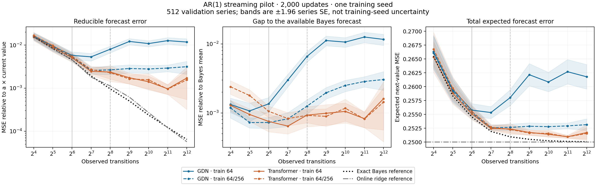
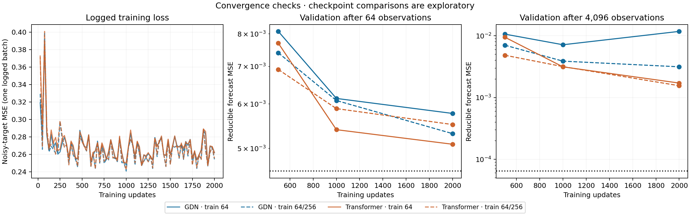

# Streaming AR(1) forecasting: first learned-model results

**Follow-up available:** [10,000 updates across three training seeds](../2026-11-23-forecast-ar1-10k/README.md). The report below preserves the initial single-seed findings.

**November 23, 2026 · Four completed runs · 2,000 updates each · One training seed · Exploratory validation**

**Main finding:** in this pilot, a Gated DeltaNet trained only on 64-observation histories becomes less accurate when its state is carried through much longer histories. Mixing 64- and 256-observation training substantially reduces that degradation with the same recurrent state size. However, the mixed GDN largely plateaus after 128–256 observations; it does not keep tracking the improving Bayesian reference. The Transformer control improves from 64 to 4,096 observations under both training regimes.



Solid lines: train on 64 observations. Dashed lines: alternate 64 and 256. Vertical markers show those training lengths. Bands are ±1.96 standard errors across 512 independent validation series, **not uncertainty across training seeds**. The Bayesian line averages exact posterior conditional risk over these histories; the other lines average measured errors on the sampled series.

## What we tested

Can a forecaster trained on short sequences keep using new observations to learn how a particular series behaves, without weight updates? We generated independent series

$$y_{t+1}=a y_t+\epsilon_{t+1},\quad a\sim\mathrm{Uniform}[-0.95,0.95],\quad \epsilon_t\sim\mathcal N(0,0.5^2),\quad y_0=0.$$

Each series has its own fixed, hidden coefficient. Both models receive observed lag pairs $(y_{t-1},y_t)$ and forecast the next value. Longer history can help estimate the hidden coefficient. These are small models trained from scratch on a controlled process, not pretrained foundation models.

During evaluation, GDN carries its recurrent state and receives only the current chunk. The Transformer receives the entire observed prefix. We evaluate one-step forecasts after 16, 32, 64, 128, 256, 512, 1,024, 2,048, and 4,096 observed transitions with frozen weights. An exact Bayesian estimator and an online ridge estimator supply compact statistical references.

## Final checkpoint results

“Reducible error” means mean squared error relative to the true noise-free next-value mean, $a y_t$. The true coefficient is used only for measurement. Total expected next-value MSE adds the irreducible innovation variance, **0.25**, to this error.

| Model and training history | Reducible error at 64 | Reducible error at 4,096 | Change from more history | Total expected MSE at 4,096 |
|---|---:|---:|---:|---:|
| GDN · 64 | 0.005773 | 0.011787 | **104.2% worse** | 0.261787 |
| GDN · 64/256 | 0.005314 | 0.003149 | 40.7% better | 0.253149 |
| Transformer · 64 | 0.005088 | 0.001718 | 66.2% better | 0.251718 |
| Transformer · 64/256 | 0.005516 | 0.001556 | 71.8% better | 0.251556 |
| Exact Bayes conditional-risk reference | 0.004557 | 0.0000644 | 98.6% lower uncertainty | 0.250064 |

For GDN, mixed training reduces long-history reducible error by **73.3%** relative to short training, corresponding to **3.3% lower total MSE**. The paired mixed-minus-short error difference at 4,096 is −0.008638, with a series-level standard error of 0.000794. The comparable Transformer difference is −0.000161 ± 0.000224 standard error: this pilot does not establish a meaningful benefit of mixing lengths for the Transformer.

GDN mixed has reducible error 0.002656 at length 256 and 0.003149 at 4,096. That increase is small relative to its paired standard error (difference 0.000493 ± 0.000587), consistent with a plateau over that range. The experiment supports **mitigation of the short-trained GDN's degradation**, not a claim that mixed training restores continued Bayesian learning.

## Training is still changing the result



Between 1,000 and 2,000 updates, long-history reducible error increases by **64.5%** for short-trained GDN, while decreasing by **19.0%** for mixed GDN and **45–51%** for the Transformers. Meanwhile, all four improve at length 64. Good short-history performance therefore does not guarantee good streaming extrapolation in this pilot.

These curves do not establish convergence. The reported primary endpoint is the planned 2,000-update checkpoint; we have not selected a better-looking checkpoint using validation performance. Predictions and metrics at all three checkpoints are included. Only the final model/optimizer checkpoint was retained; earlier checkpoint predictions remain available.

## What this supports, and what it leaves open

- **A concrete effect to replicate:** training-history length changes GDN's long-stream behavior without changing its state size. The Transformer controls do not show the same degradation in this seed.
- **No memory impossibility claim:** the exact Bayesian reference needs only two running sums. Constant memory is mathematically sufficient for this task. Poor learned forecasts could reflect optimization, the learned update rule, numerical behavior, model design, or training distribution.
- **No broad architecture ranking:** there is one training seed, the models have different parameter counts, and training has not settled. No state-size intervention or mechanism experiment was performed.
- **Limited practical scope:** one-step AR(1) is a sanity check. At length 64, most achievable total forecast accuracy is already present: the exact reference improves total MSE by only about 1.8% between 64 and 4,096 on these validation histories. Claims about useful foundation-model forecasting need richer dynamics and pretrained-model or real-data evaluation.

The highest-value next step is to replicate the short-versus-mixed GDN contrast across training seeds while checking whether additional optimization changes it. Freeze that protocol before opening confirmation data. Then use a richer process with a measurable forecasting benefit from longer history. **No follow-up runs have been launched.**

## Resolved experiment settings

| Setting | Value |
|---|---|
| Training seed | 182 for all four runs |
| Model structure | 2 layers, width 64, 4 heads, feed-forward width 256 |
| Parameters | GDN 110,641; Transformer 99,841 |
| GDN state | 3,200 FP32 elements = 12,800 bytes per series, plus latest raw scalar; excludes weights and temporary chunk activations |
| GDN execution | Exact PyTorch gated-delta chunks of 64; causal convolution size 4 |
| Transformer | Causal attention, no positional embeddings, no dropout |
| Training budget | 2,000 updates × 2,048 prediction positions = 4,096,000 positions per run |
| Short / mixed batches | 32 × 64 / alternate 32 × 64 and 8 × 256 |
| Distinct training series | Short 64,000; mixed 40,000 |
| Optimizer | Adam, LR 0.0003, betas 0.9/0.999, epsilon 1e-8, no weight decay, gradient clip 1 |
| Precision | FP32; TF32 and autocast disabled |
| Validation | Same 512 series, seed 920000000; nested histories |
| Confirmation | Seed 940000000, 1,024 series; **unopened** |
| Hardware | Personal Modal A100 40GB, 2 CPU, 8 GiB RAM per job |

Prediction-token budgets and update counts match; series counts, FLOPs, and model parameter counts do not. This implementation checks forecasting behavior and state handling; its timings are not a production-kernel architecture benchmark.

## Verification and resource use

All four runs completed 2,000 updates. Saved checkpoint configurations and source fingerprints match the launched code. Every saved prediction file was rescored locally and matches its recorded metrics. All four used bit-identical validation observations and coefficients. Replaying two series at every evaluated history length from each final checkpoint on CPU agrees with the saved GPU predictions to within **3.9×10⁻⁷**. GPU preflight causality and carried-state checks passed. See [verification](verification.json) and [GPU preflight](gpu_preflight.json).

The timed sections of the preflight and four training jobs total **281.14 seconds**, giving an estimated **$0.18** of running compute at the [published Modal rates](https://modal.com/pricing). This excludes image building, container startup/load, artifact commits, scale-down, storage, and egress; it is **not the final billed total**. All five Modal apps were verified stopped with zero tasks after collection.

GitHub identity is **Alex2262**, repository **Alex2262/project182**. Compute and artifacts use Modal workspace **alexander-tian** and volume **project182-artifacts**. Live job logs verified personal W&B identity **alexander-tian**, destination **alexander-tian-ucb/project182**. **No MatX compute, repository, storage, or logging service was used.**

## Files and live run records

- [Full metrics CSV](metrics.csv), [summary and paired contrasts](summary.json), and [training histories](training_histories.json).
- [Resolved YAML configurations](configs/), [saved predictions](predictions/), and [compact validation reference](validation_reference.npz).
- [Manifest with Modal apps, timing, and provenance](manifest.json); [experiment source snapshot](source/).
- Personal W&B: [GDN short](https://forge.coreweave.com/wandb/alexander-tian-ucb/project182/runs/alex_261123_ar1_gated_deltanet_short_s182), [GDN mixed](https://forge.coreweave.com/wandb/alexander-tian-ucb/project182/runs/alex_261123_ar1_gated_deltanet_mixed_s182), [Transformer short](https://forge.coreweave.com/wandb/alexander-tian-ucb/project182/runs/alex_261123_ar1_transformer_nope_short_s182), [Transformer mixed](https://forge.coreweave.com/wandb/alexander-tian-ucb/project182/runs/alex_261123_ar1_transformer_nope_mixed_s182).

Final weights, optimizer states, and full validation observations are stored in the personal Modal volume under `forecast_v1/runs/<run_name>/` and locally under `outputs/forecast_v1/<run_name>/`. Large raw artifacts are excluded from Git; this report contains the compact materials needed to inspect the results.

To regenerate figures and tables from downloaded raw runs, from the repository root with `requirements-forecast.txt` installed:

```bash
python scripts/summarize_forecast.py \
  --raw outputs/forecast_v1 \
  --output outputs/forecast_report_regenerated \
  --manifest results/2026-11-23-forecast-ar1/manifest.json
```

The plan and metric definitions are in [the experiment plan](../../docs/forecast_pilot.md). Compact predictions, references, plots, and tables are included with this report.
