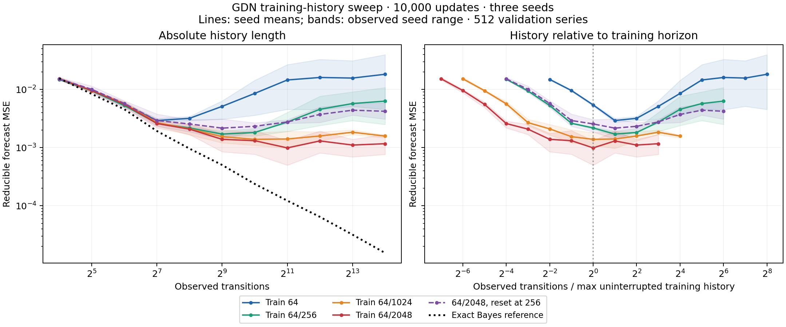
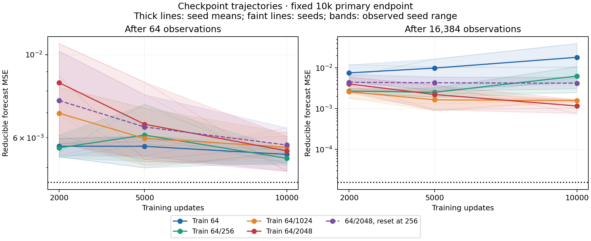

# Does longer training history fix streaming deterioration?

Follow-up completed: [30k optimization continuations](../2026-11-23-forecast-optimization/README.md) test whether additional training and learning-rate decay close the remaining gap.

**November 23, 2026 · Nine new training runs and six extended evaluations completed · Three seeds per condition · All apps stopped**

**Longer training histories substantially mitigate deterioration, but do not restore continued Bayesian improvement.** Training on 64/1,024 or 64/2,048 histories produces much lower long-stream error than the shorter-history conditions. The curves largely reach a lower error floor. Some seeds still deteriorate; others do not meet the predeclared deterioration criterion within the tested range. The results do not establish one universal failure point proportional to training length.



Lines show mean errors across three separately trained models. Bands show the **observed minimum–maximum range across those seeds**, not confidence intervals. The right panel divides history by the maximum uninterrupted training history; the reset control therefore uses 256 as its denominator. Compare where curves change shape; different absolute error levels need not collapse onto one curve after rescaling.

## Final forecast errors

Reducible error is squared error relative to the true conditional next-value mean, $a y_t$. The true coefficient is never a model input. Total expected predictive MSE adds innovation variance **0.25**. Values after ± are sample standard deviations across training seeds.

| Training condition | Reducible error at 64 | Reducible error at 16,384 | Total expected MSE at 16,384 |
|---|---:|---:|---:|
| Always 64 | 0.005416 | 0.018233 ± 0.018790 | 0.268233 |
| Alternate 64 / 256 | 0.005288 | 0.006299 ± 0.004175 | 0.256299 |
| Alternate 64 / 1,024 | 0.005667 | 0.001579 ± 0.000095 | 0.251579 |
| Alternate 64 / 2,048 | 0.005534 | **0.001167 ± 0.000469** | **0.251167** |
| Same 64 / 2,048 data, reset every 256 | 0.005738 | 0.004214 ± 0.001469 | 0.254214 |
| Exact Bayes conditional-risk reference | 0.004557 | 0.00001543 | 0.250015 |

Short-history performance stays broadly comparable. The main separation appears as deployment history grows. The 64/2,048 mean reaches its minimum near 2,048 observations (0.000989), then fluctuates around 0.001–0.0013 through 16,384. The Bayesian reference keeps improving; at 16,384, the learned model's reducible error is about **76 times** the reference, although the difference in ordinary total MSE is small because noise dominates.

## The matched control strengthens the interpretation

The continuous 2,048 and reset-256 conditions use identical generated observations, targets, initial weights, loss weights, and optimizer-update counts within each seed. Resetting changes forward history access and the backpropagation span; this experiment does not distinguish those two mechanisms.

| Seed | Continuous 2,048 error at 16,384 | Reset-256 error | Reduction from continuous training |
|---|---:|---:|---:|
| 182 | 0.001683 | 0.003682 | 54.3% |
| 183 | 0.001054 | 0.003085 | 65.8% |
| 184 | 0.000764 | 0.005875 | 87.0% |

Continuous training wins in all three seeds. The ratio of seed-mean errors gives a **72.3% reduction in reducible error**, or **1.2% lower total expected MSE**. This supports the value of uninterrupted long-history training beyond differences in the number of underlying series per batch. It does not isolate a gate, prove an architectural limitation, or establish statistical consistency.

## Does the deterioration point move?

The rule was fixed before launch: find the first tested history length where error is at least **25% above its earlier minimum** and remains above that same threshold at the next tested length. The table reports that first length; parentheses show the multiple of maximum uninterrupted training history.

| Training condition | Seed 182 | Seed 183 | Seed 184 |
|---|---|---|---|
| Always 64 | 512 (8×) | 2,048 (32×) | 256 (4×) |
| 64 / 256 | 4,096 (16×) | 2,048 (8×) | 1,024 (4×) |
| 64 / 1,024 | None confirmed | 8,192 (8×) | 4,096 (4×) |
| 64 / 2,048 | None confirmed* | None confirmed | 4,096 (2×) |
| 64 / 2,048, reset256 | 2,048 (8×) | None confirmed | 1,024 (4×) |

“None confirmed” means the rule did not trigger through 16,384; it does not mean indefinite learning or low error. *For continuous 2,048, seed 182 rises above the threshold only at the final test length, so the required subsequent confirmation point is unavailable.* Reset-control seed 183 also avoids the criterion, yet has a substantially higher error floor than continuous training.

Longer training often delays deterioration, but the locations vary considerably. In particular, seed 184's deterioration point stays at 4,096 when training increases from 1,024 to 2,048, while its error level improves. The evidence supports **partial mitigation and a lower floor**, with delayed deterioration in several cases; it does not support a clean universal scaling law or a permanent fix.

## Training duration remains relevant



| Updates | Train 64 | 64/256 | 64/1,024 | 64/2,048 | 64/2,048 reset256 |
|---|---:|---:|---:|---:|---:|
| 2,000 | 0.007565 | 0.002700 | 0.002606 | 0.004058 | 0.004446 |
| 5,000 | 0.009930 | 0.002519 | 0.001652 | 0.002231 | 0.004326 |
| 10,000 | 0.018233 | 0.006299 | 0.001579 | 0.001167 | 0.004214 |

These are mean reducible errors at 16,384 observations. The longest continuous-training condition is still improving substantially between 5k and 10k updates. We have not established convergence. The primary endpoint was fixed at 10k before launch; earlier checkpoints are shown as trajectories, not selected as alternative winners.

## Scope and protocol

This is a synthetic one-step AR(1) control: each independent series draws a hidden coefficient uniformly from [−0.95,0.95], innovation standard deviation is 0.5, and the initial value is zero. Inputs are observed lag pairs. The exact Bayesian reference can use two running sums plus the latest value, so constant memory is sufficient for the statistical problem. These results characterize this learned GDN setup, not recurrent forecasters or time-series foundation models in general.

All models have two layers, width 64, four heads, 110,641 parameters, and 12,800 bytes of carried FP32 state per series plus the latest scalar. New runs start from scratch with seeds 182/183/184, Adam LR 0.0003, betas 0.9/0.999, epsilon 1e-8, no weight decay, gradient clip 1, and a constant schedule. No TF32 or autocast. Each run has 10,000 updates × 2,048 prediction positions = **20,480,000 training positions**. Counts of independent training series differ across lengths; the matched reset control preserves those counts exactly relative to continuous 2,048.

Evaluation uses the same 512 validation series, seed 920000000, extended to histories 16–16,384. Weights stay frozen and state is carried continuously in every condition, including the reset-trained models. The six earlier GDN models were evaluated from their existing 2k/5k/10k checkpoints; no baseline retraining occurred. The separate confirmation set remains **unopened**.

The full registered protocol is in [the sweep plan](../../docs/forecast_horizon.md). No additional architectures, learning rates, longer endpoints, or confirmation evaluations were launched.

## Verification, accounts, and cost

The reset implementation was checked against separate block forwards and gradients, with no influence across a reset boundary. The no-reset path matches the original forward computation. GPU preflight passed at 64, 1,024, 2,048, and 2,048 with reset256, including 16k streaming inference.

All 45 checkpoint/condition evaluations were rescored from saved predictions. Source fingerprints and all 27 newly retained checkpoints were verified, together with the 18 reused checkpoint references. Two series from each final model were replayed on CPU at all eleven history lengths. Extended baseline predictions through 4,096 were checked against their original files. Detailed numerical tolerances and differences are in [metric verification](metric_verification.json), [checkpoint verification](checkpoint_verification.json), [CPU checks](cpu_verification.json), and [GPU preflight](gpu_preflight.json).

All fifteen jobs and the preflight app were verified stopped with zero tasks. Instrumented runtime totals **10,328.26 seconds**, giving an estimated **$6.48 of running compute** at the [published Modal rates](https://modal.com/pricing). This excludes build/startup, initial checkpoint loading, artifact commits, scale-down, storage, and egress; it is not the final billed total.

Personal resources only: GitHub **Alex2262/project182**, Modal workspace **alexander-tian**, volume **project182-artifacts**, and W&B **alexander-tian-ucb/project182**. All nine new training logs verified the personal W&B identity. No MatX compute, repository, storage, or logging service was used.

## Files and reproduction

- [Metrics CSV](metrics.csv), [summary including every seed's deterioration point](summary.json), [training histories](training_histories.json).
- [Resolved configurations](configs/), [predictions](predictions/), [compact validation reference](validation_reference.npz).
- [Manifest with Modal and W&B links](manifest.json), [final app states](app_status.json), [source snapshot](source/).
- [Previous three-seed experiment](../2026-11-23-forecast-ar1-10k/README.md).

All fifteen downloaded job directories are saved locally under `outputs/forecast_horizon/<run_name>/`. Existing parent checkpoints remain in `outputs/forecast_v1/`. Cloud locations are recorded per job in the manifest. Large raw data and weights are excluded from Git.

To reproduce figures and tables from the repository root:

```bash
python scripts/summarize_forecast_horizon.py \
  --raw outputs/forecast_horizon \
  --output outputs/forecast_horizon_report_regenerated \
  --manifest results/2026-11-23-forecast-horizon/manifest.json
```

Compact predictions, references, plots, tables, and verification artifacts are included with this report. Raw checkpoints remain outside Git.
