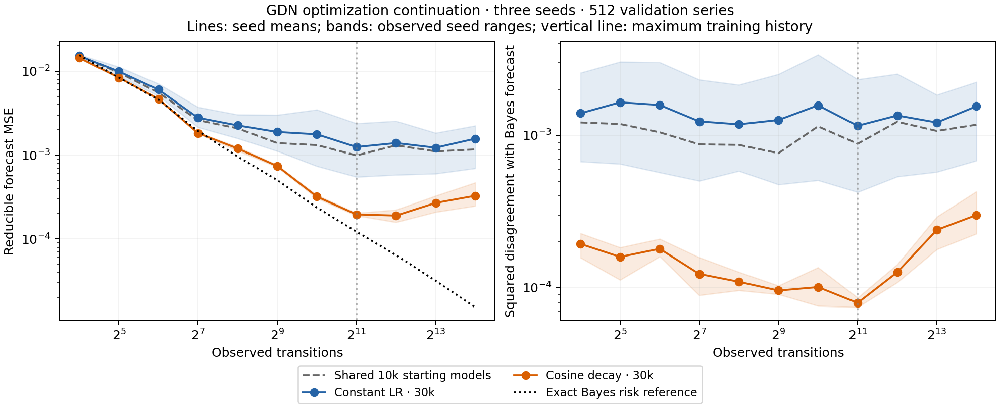
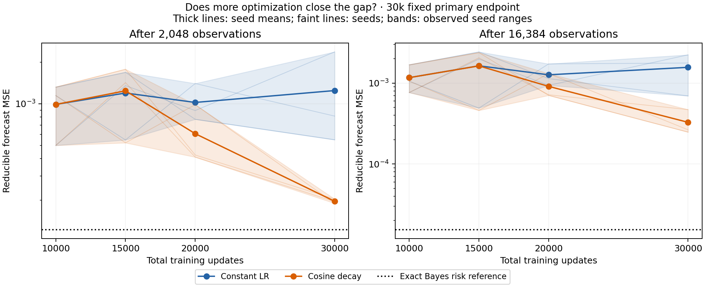

# Optimization helps substantially, but the long-history gap remains

**November 23, 2026 · Six completed 10k-to-30k continuations · Three paired seeds · Fixed 30k endpoint**

**The learning-rate schedule explains a substantial part of the previous error floor. It does not explain away the failure to keep improving with longer deployment histories.** At 30k updates, cosine decay reduces mean reducible error at 16,384 observations by **79.1% versus constant learning rate**, winning in all three seed pairs. It also improves on the shared 10k starting models by **71.9%**. Nevertheless, its error increases as history grows from 2,048 to 16,384 in every seed, while the exact Bayesian reference improves.



Lines show means over three training seeds; bands show the observed seed minimum–maximum range, not confidence intervals. The gray curve is the shared 10k starting point. The vertical line marks the longest training history, 2,048 observations. The Bayesian risk reference applies to the left panel; the right panel measures squared disagreement with the Bayesian prediction, whose ideal value is zero.

## Primary endpoint

Reducible error is squared error relative to the true conditional next-value mean, $a y_t$. The hidden coefficient is never a model input. Total expected predictive MSE adds innovation variance **0.25**. The ± values below are sample standard deviations across training seeds.

| Model condition | Reducible error at 2,048 | Reducible error at 16,384 | Total expected MSE at 16,384 |
|---|---:|---:|---:|
| Shared 10k starting models | 0.000989 | 0.001167 ± 0.000469 | 0.251167 |
| 30k, constant LR 0.0003 | 0.001246 | 0.001566 ± 0.000789 | 0.251566 |
| 30k, cosine LR 0.0003 → 0.00003 | **0.000197** | **0.000327 ± 0.000124** | **0.250327** |
| Exact Bayes conditional-risk reference | 0.000122 | 0.00001543 | 0.250015 |

At the fixed final checkpoint, constant-LR training is worse on average than the 10k starting point, with substantial seed variation. Cosine decay improves substantially. The 79.1% reduction concerns the reducible component; it corresponds to **0.49% lower total expected MSE** versus constant LR because irreducible noise dominates this task.

| Seed | Constant LR error at 16k | Cosine error at 16k | Reduction from decay |
|---|---:|---:|---:|
| 182 | 0.000694 | 0.000248 | 64.3% |
| 183 | 0.001769 | 0.000265 | 85.0% |
| 184 | 0.002233 | 0.000470 | 78.9% |

Within each pair, both branches start from the same weights and complete Adam state and receive the same subsequent observations, targets, and number of updates. The declared learning-rate schedule is the experimental difference. This supports an effect of optimization settings at this budget. It does not establish whether decay primarily helps convergence, reduces fluctuations, changes the learned update rule, or combines those effects.

## Better accuracy does not mean continued learning from longer histories

The cosine models' mean reducible error is **0.000197 at 2,048 observations** and **0.000327 at 16,384**: an eightfold increase in available history produces **66.7% higher error**. The mean reaches its lowest tested value near 4,096 (0.000190), then rises at 8,192 and 16,384. All three seeds have higher error at 16,384 than at 2,048.

The Bayesian reference moves in the opposite direction, from 0.000122 to 0.00001543. At 2,048, the cosine model's mean reducible error is about 1.6 times that reference; at 16,384 it is about **21 times** the reference. Direct squared disagreement with the Bayesian predictor also increases, from **0.0000795** to **0.000300**, so this conclusion does not rely only on the empirical error relative to the latent coefficient.

All three cosine seeds also trigger the previously declared deterioration rule at **8,192 observations (4× the longest training history)**, confirmed at 16,384. The rule requires a rise of at least 25% above the earlier minimum, sustained at the next tested length. This is a consistent descriptive result at one training-history length, not evidence of a universal scaling law or an architectural limit.

The defensible conclusion is that optimization accounts for a large part of the original error level, while longer-history generalization remains unresolved after this intervention. These results do not prove that GDN cannot learn the task, that 30k is converged, or that other schedules or objectives would fail.

## Checkpoint trajectories



The 15k checkpoint was mixed: one seed improved and two worsened relative to 10k, with little separation between schedules. At 20k, cosine decay beat constant LR at 16k in all three seeds, reducing mean reducible error by about 28%. The schedule separation is larger at the predeclared 30k endpoint. All retained checkpoints are shown; no best checkpoint was selected after seeing validation results.

More training here means both more optimizer updates and more freshly generated training examples. The paired schedule comparison holds that data budget fixed. We have not measured convergence under every optimization method, and three training seeds provide limited precision about the distribution of training outcomes.

## Protocol

These are continuations of the continuous 64/2,048 models in the [previous training-history sweep](../2026-11-23-forecast-horizon/README.md). Each branch adds exactly **20,000 updates × 2,048 prediction positions = 40,960,000 positions**; including its parent, each final model has seen 61,440,000 positions. Seeds are 182/183/184. The cosine schedule starts at 0.0003 on update 10,001 and ends at 0.00003 on update 30,000.

The architecture and other training settings remain fixed: two GDN layers, width 64, four heads, 110,641 parameters, FP32, Adam betas 0.9/0.999, epsilon 1e-8, no weight decay, and gradient clipping at 1. Training alternates histories of 64 and 2,048 observations, with no state resets within a history. Evaluation freezes weights and carries state continuously.

This remains a synthetic one-step AR(1) control with an independent hidden coefficient uniform on [−0.95,0.95] per series, innovation standard deviation 0.5, and initial value zero. Constant memory suffices for exact Bayesian inference through running sufficient statistics. This experiment concerns the learned algorithm in this GDN setup; it is not a benchmark of time-series foundation models or evidence of a general fixed-memory impossibility.

All evaluations use the same 512 validation series, seed 920000000, at histories 16–16,384. The separate confirmation set remains **unopened**. The [registered continuation protocol](../../docs/forecast_optimization.md) fixes the schedules, checkpoints, and endpoint.

## Verification and execution

CPU checks established exact uninterrupted-versus-resumed training for both schedules, including a mid-decay restart, and preservation of the real parent weights and Adam states. All 24 checkpoint evaluations were recomputed from saved predictions. The 24 retained checkpoint files, Adam update counts, saved learning rates, and model/data source fingerprints were checked; two series from each final model were replayed on CPU at every tested history length.

Two runs—constant seed 182 and cosine seed 183—were interrupted twice by local Modal connection failures. They resumed from verified checkpoints at 25,847 then 28,603 updates, and 25,007 then 27,845 updates, respectively. Their model, Adam state, data index, schedule, and final endpoint were preserved; no restart from scratch or additional experimental condition was introduced. The launcher now submits once and retries only result reads using [Modal's function-call interface](https://modal.com/docs/guide/job-queue). Real training failures still propagate. All ten apps used across the six runs and four recoveries were verified stopped with zero tasks.

Estimated running compute is **$9.08**, including the recorded portions of the interrupted attempts. This uses instrumented runtime and [Modal's published resource rates](https://modal.com/pricing); it excludes startup/load, artifact commits, scale-down, storage/egress, and the brief unlogged tails before interruptions. It is an estimate, not a billing receipt.

Personal resources only: GitHub **Alex2262/project182**, Modal **alexander-tian**, volume **project182-artifacts**, and W&B **alexander-tian-ucb/project182**. Every initial and resumed training job verified the personal W&B identity. No MatX compute, repository, storage, or logging service was used.

## Files and reproduction

- [Metrics CSV](metrics.csv), [summary and paired seed comparisons](summary.json), [training histories](training_histories.json).
- [Resolved configurations](configs/), [saved predictions](predictions/), [compact validation reference](validation_reference.npz).
- [Manifest with run links and recovery provenance](manifest.json), [app states](app_status.json), [source snapshot](source/).
- [Metric verification](metric_verification.json), [checkpoint verification](checkpoint_verification.json), [resume checks](cpu_verification.json), [polling checks](polling_verification.json).
- [First interruption checkpoint checks](recovery_checkpoint_verification.json), [second interruption checkpoint checks](recovery2_checkpoint_verification.json).

Full raw files and weights are saved locally under `outputs/forecast_optimization/<run_name>/`; parent checkpoints remain under `outputs/forecast_horizon/`. Large raw files are excluded from Git. From the repository root:

```bash
python scripts/summarize_forecast_optimization.py \
  --raw outputs/forecast_optimization \
  --output outputs/forecast_optimization_report_regenerated \
  --manifest results/2026-11-23-forecast-optimization/manifest.json
```

This report includes the compact predictions, references, plots, and tables needed to reproduce the analysis. Raw checkpoints remain outside Git.
