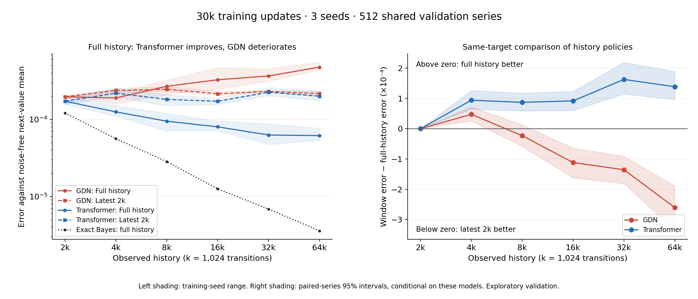

# Transformer benefits from full history; GDN benefits from recent replay at 64k

**November 24, 2026 · Three training seeds per architecture · 512 paired validation series · All six jobs finished**

The GDN full-history disadvantage persists through 32k and 64k. The matched NoPE
Transformer shows the opposite policy preference: full history beats replaying
the latest 2,048 transitions at every tested origin beyond 2,048, in all three
training seeds. Its mean full-history error declines across tested origins,
with little additional improvement between 32k and 64k.



Left bands are observed training-seed ranges. Right bands are pointwise 95%
paired-series bootstrap intervals conditional on the three fixed models. These
are not intervals over arbitrary training runs. k means 1,024 transitions.

## Results

All values below are mean squared error against the noise-free next-value mean,
averaged across three independently trained models, **multiplied by 10,000**.
Lower is better. Add 0.25 to the unscaled errors for total expected predictive MSE.

| History | GDN full | GDN latest 2k | Transformer full | Transformer latest 2k | Exact Bayes full |
|---|---:|---:|---:|---:|---:|
| 2k | 1.965 | 1.965 | 1.725 | 1.725 | 1.210 |
| 4k | 1.903 | 2.377 | 1.253 | 2.193 | 0.563 |
| 8k | 2.693 | 2.463 | 0.949 | 1.819 | 0.283 |
| 16k | 3.275 | 2.156 | 0.802 | 1.721 | 0.126 |
| 32k | 3.667 | 2.312 | 0.628 | 2.255 | 0.069 |
| 64k | 4.769 | 2.162 | 0.617 | 2.004 | 0.036 |

At 64k, recent-window replay reduces GDN's reducible error by **54.7%**, from
0.000476897 to 0.000216230. Its paired window-minus-full difference is −0.000260667,
with 95% interval [−0.000337125, −0.000189039]. Every training seed favors replay.
The corresponding reduction in total expected MSE is **0.104%**.

For the Transformer, full history reduces reducible error by **69.2%** relative
to latest-2k replay, from 0.000200359 to 0.000061685. Its window-minus-full
difference is +0.000138674, with 95% interval [+0.000096023, +0.000189038]. Every
training seed favors full history. Its total expected MSE reduction relative to
window replay is approximately **0.055%**.

The full-history GDN/Transformer reducible-error ratio grows from approximately
1.14 at 2k to 7.73 at 64k. The Transformer remains about 17 times above the exact
Bayesian predictor's empirical reducible error at 64k, so this is not evidence
that it has learned statistically optimal indefinite accumulation.

## Interpretation and limits

Longer histories contain useful forecasting evidence on this task, and a learned
Transformer can exploit some of it far beyond its maximum training history.
The observed GDN deterioration is therefore not an unavoidable feature of this
task or of all models trained with the same sequence lengths. This supports
investigating how the GDN learns and maintains its state.

It does not identify the mechanism, prove an inherent recurrent-memory limit,
or generalize to other architectures and forecasting processes. The AR(1)
Bayesian solution itself needs only a small set of running statistics.
The models share width, layer count, data, update count, token budget and optimizer
schedule, but not parameter count: GDN has 110,641 parameters, Transformer 99,841.
The shared recipe is not evidence of equal architecture-specific optimization.

The 512-series validation cohort has guided prior experiments. These results are
exploratory; confirmation seed 940000000 remains unopened. Intervals are pointwise
with no multiple-comparison correction. Large relative reductions refer to the
small reducible component of error, not total forecast MSE. Recent-window replay
reprocesses 2,048 transitions per forecast and is not equivalent to periodically
resetting a live stream.

## Protocol and checks

- GDN reuses the final 30k cosine checkpoints, seeds 182/183/184. Transformers
  train fresh for 30k updates, alternating histories 64/2,048 with 2,048 prediction
  positions/update. Adam LR 0.0003 for 10k updates, then cosine to 0.00003; FP32.
- Evaluation origins: 2,048/4,096/8,192/16,384/32,768/65,536. Same 512 series and
  same targets across every model and policy. No evaluation-based checkpoint selection.
- Transformer evaluation retains exact full causal attention, using query blocks
  to bound temporary memory. GPU preflight agrees with ordinary attention within
  3.73e-8 on the tested trained checkpoint and passes a future-perturbation check.
- Independently rescored every downloaded model/policy/origin metric; verified
  all six checkpoint hashes. Targets, latent coefficients and Bayesian means
  are bit-identical across evaluations. A few reference variance entries differ
  by at most 8.48e-22 from float64 rounding; this is recorded explicitly.
- Full/window predictions agree at 2k. GDN full-history predictions reproduce the
  previous saved results within 4.77e-7, with bit-identical original data prefixes.
- Fresh CPU replay checks on all three new Transformer checkpoints agree with
  saved GPU predictions within 1.20e-7; ordinary and blocked attention agree too.
- All seven apps, including preflight, were verified stopped with zero tasks.
  Measured function runtimes imply approximately $1.87 in running compute at the
  rate recorded during preflight. This excludes startup, storage and other overhead,
  and is not a final billing total.
- Personal Modal `alexander-tian`, W&B `alexander-tian-ucb/project182`, personal
  `project182-artifacts` volume. No MatX services used. No new experiments launched
  while preparing this report, and no commit or push performed.

## Artifacts

- [Full summary](summary.json), [per-seed metrics](metrics.csv),
  [paired comparisons](paired_contrasts.csv), [reference predictions](reference.npz).
- [Independent verification](independent_verification.json),
  [CPU checks](cpu_verification.json), [GPU preflight](preflight_result.json).
- [Job links and launch manifest](launch_manifest.json), [resolved batch](batch.json),
  [final app status](app_status_after.json), [compact model outputs](artifacts/),
  [source snapshot](source/), [PDF figure](comparison_64k.pdf).

Raw final Transformer checkpoints and downloaded outputs are retained under
`outputs/forecast_long_artifacts/`; GDN checkpoints remain under
`outputs/forecast_optimization/`. Raw weights are excluded from Git.

To regenerate from retained downloads:

```bash
PYTHONPATH=src python scripts/summarize_forecast_long.py \
  --repo "$PWD" --output outputs/forecast_64k_regenerated
```
