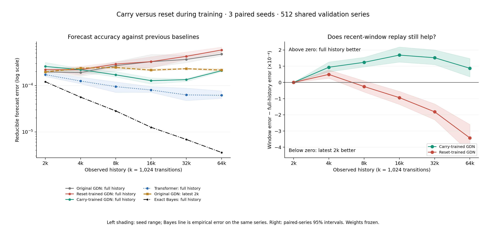

# Training on accumulated state partially repairs long-history GDN performance

**November 24, 2026 · Six completed continuations · Three paired training seeds · 512 shared validation series**

Keeping the 16k warm-up state during additional training substantially improves
full-history forecasting, despite backpropagating only through the following 2k
positions. Discarding that state in the matched reset control does not improve
long-history performance. The carry model's error nevertheless rises again beyond
16k, and its short-history performance regresses.



Left: log-scale forecast error, including the original GDN latest-2k replay
baseline, the full-history Transformer, and the exact full-history Bayesian predictor.
Shading shows observed training-seed ranges; the Bayes line is empirical error
against the same latent means, not posterior risk. Right: latest-2k replay error
minus full-history error, with pointwise paired-series 95% intervals conditional
on the three fixed models. All weights are frozen during evaluation.

## Forecast error by history policy

Values are squared error against the noise-free next-value mean, averaged across
three trained models. Add 0.25 for total expected predictive MSE.

| Condition | 2k | 16k | 32k | 64k |
|---|---:|---:|---:|---:|
| Original GDN, 30k updates | 0.000197 | 0.000327 | 0.000367 | 0.000477 |
| Reset control, +3k updates | 0.000220 | 0.000329 | 0.000428 | 0.000587 |
| Carry-state training, +3k updates | 0.000259 | 0.000128 | 0.000134 | 0.000210 |
| Prior Transformer, full history | 0.000172 | 0.000080 | 0.000063 | 0.000062 |
| Original GDN, latest-2k replay | 0.000197 | 0.000216 | 0.000231 | 0.000216 |
| Exact Bayes, full history | 0.000121 | 0.000013 | 0.000007 | 0.000004 |

At 64k, carry reduces reducible error by **64.3% versus reset** and **56.1% versus
the original parent**. All three seeds improve in both comparisons. The primary
carry-minus-reset difference is −0.000377866, with paired 95% interval
[−0.000445843, −0.000316428]. The improvement over the original full-history model
also excludes zero: [−0.000328354, −0.000210714]. The total expected MSE reduction
versus reset is approximately **0.151%**; unpredictable noise dominates total MSE.

## The replay comparison reverses, with qualifications

At 64k the carry-trained model prefers full history (0.000209546) over latest-2k
replay (0.000296761), in all three seeds. The replay-minus-full interval is
[+0.000034641, +0.000147283]. The reset control continues to prefer replay.

This reversal includes a real absolute full-history improvement, not merely a
decline in replay performance. However, replay performance does decline, and the
carry model's 2k error is approximately 32% worse than its original parent.

The repair is incomplete: carry full-history error rises from 0.000127822 at 16k
to 0.000209546 at 64k, an approximately 64% increase. Every seed has higher error
at 64k than at 16k. This curve comparison is between different forecast targets;
the within-origin replay comparison remains the direct policy intervention.

At 64k, the new carry model's full-history accuracy is close to the original
model's latest-2k replay accuracy (0.000216230). Their paired difference interval
[−0.000048970, +0.000033554] crosses zero. We therefore have not demonstrated an
accuracy improvement over that previous deployment policy. Computational costs
of continuous streaming and replay differ and have not been benchmarked here.

## What this supports

Training with accumulated state can improve long-history behavior without
backpropagating through the full warm-up. The matched reset control rules out
the explanation that this gain simply came from the same number of additional
updates on the scored suffix. State exposure/history access during training is
therefore a useful intervention in this setup.

This does not uniquely identify a gate or numerical mechanism, separate state
age from the evidence carried in state, or prove gradients longer than 2k could
not help further. It does not establish indefinite length generalization or an
architectural limit. The Transformer reference is the existing 30k model, not a
matched additional-training control for this experiment.

The 512-series validation cohort has guided prior choices; these are exploratory
findings. Confirmation seed 940000000 remains unopened. Bootstrap intervals use
5,000 paired series resamples, seed 26112433, with no multiple-testing correction
and no claim to capture uncertainty over arbitrary training runs.

## Protocol and verification

Both arms start from the same parent weights and Adam state within each seed,
execute an identical 16,384-transition warm-up without gradients, and score the
following 2,048 transitions. Carry retains detached recurrent and convolution
states; reset discards both. Training uses fresh matched streams, 3,000 updates,
constant LR 0.00003, FP32, and unchanged gradient clipping. No test-time training.

All six final and parent checkpoint hashes were verified; all downloaded metrics
were independently rescored. Paired model/training configurations match except
the declared state intervention. Evaluation targets and reference means match
the original cohort exactly; negligible float64 variance rounding is tolerated
at 1e-18. Fresh CPU replay checks of all six final models are recorded separately.
Preflight verified forward and gradient equivalence, detached prefix computation,
and exactly matched paired training data.

All experiment apps were verified stopped with zero tasks. Instrumented runtime
implies approximately **$7.09 running compute** at the recorded preflight rate,
excluding startup and other billing overhead. Only personal Modal/W&B resources
were used. No new experiments, commits, or pushes were performed for this report.

## Artifacts

- [Summary](summary.json), [per-model metrics](metrics.csv), [paired contrasts](paired_contrasts.csv).
- [Verification](independent_verification.json), [CPU replay](cpu_verification.json),
  [GPU preflight](preflight_result.json), [final app status](app_status_after.json).
- [Resolved batch](batch.json), [job links](launch_manifest.json), [compact outputs](artifacts/),
  [source snapshot](source/), [PDF figure](carry_vs_reset.pdf).

Final weights remain under `outputs/forecast_warmup_artifacts/`, excluded from Git.
Reproduce from retained local downloads:

```bash
PYTHONPATH=src python scripts/summarize_forecast_warmup.py \
  --repo "$PWD" --output outputs/forecast_warmup_regenerated
```
