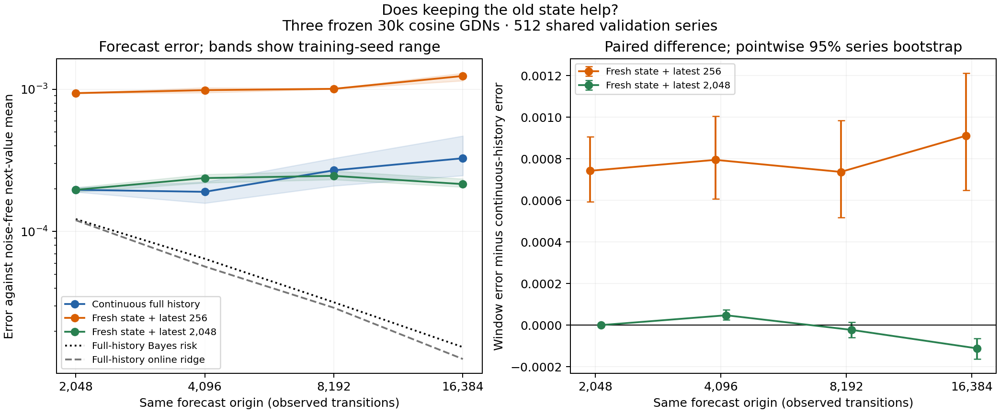

# Carrying older state helps at 4k, but recent-window replay wins at 16k

**November 24, 2026 · Three frozen models · 512 paired validation series · Local CPU evaluation · Exploratory results**

At the same forecast targets, continuous history beats replaying the latest 2,048 transitions at origin 4,096 in all three models. At origin 16,384, the comparison reverses in all three: recent-window replay reduces mean reducible error by **34.2%**, or **0.0447% of total expected forecast MSE**. The 256-transition window is substantially worse than continuous history at every tested origin.



Left: mean losses across three separately trained models, not ensemble predictions; shaded bands are the observed training-seed ranges. Right: window-minus-continuous loss differences, with pointwise paired bootstrap intervals over independent series conditional on these three fixed models. Positive differences favor continuous history.

## Fixed-origin results

Reducible error is squared error against the hidden noise-free next-value mean a*y[t]. The hidden coefficient is used only for scoring. Add 0.25 to obtain total expected next-value MSE.

| Forecast origin | Continuous full history | Latest 256, fresh state | Latest 2,048, fresh state |
|---|---:|---:|---:|
| 2,048 | 0.000196504 | 0.000939104 | 0.000196503 |
| 4,096 | 0.000190287 | 0.000985586 | 0.000237697 |
| 8,192 | 0.000269336 | 0.001006641 | 0.000246331 |
| 16,384 | 0.000327486 | 0.001239111 | 0.000215564 |

The primary comparison, fixed before this evaluation, is the 2,048-window versus continuous history at origin 16,384. Its mean loss difference is **−0.000111923**, with a **95% paired-series bootstrap interval [−0.000163199, −0.000064932]**. This interval conditions on the three existing models and does not quantify uncertainty over arbitrary training runs. The average improvement is influenced by seed 184; all seed-specific results are shown below.

| Training seed | Continuous at 16k | Latest 2,048 at 16k | Reducible-error reduction |
|---|---:|---:|---:|
| 182 | 0.000247724 | 0.000234727 | 5.2% |
| 183 | 0.000264589 | 0.000205568 | 22.3% |
| 184 | 0.000470146 | 0.000206396 | 56.1% |

At 4,096, full history has lower error than the 2,048 window in every seed; the paired interval for window-minus-full is [0.000025613, 0.000073263]. At 8,192 the interval crosses zero, and seed-level directions differ. We therefore do not identify a precise universal crossover point. These supporting intervals are pointwise and have no multiple-comparison correction.

At 16,384, squared disagreement with the full-history Bayesian forecast also falls, from **0.000299675** to **0.000201836**. The result therefore appears in both latent-mean error and direct Bayes disagreement. The full-history online ridge reference has empirical reducible error **0.000012726**; the exact Bayes forecast has empirical latent-mean error **0.000012564** on these series. Its mean conditional posterior risk is **0.000015426**. The conditional risk and realized latent-mean errors are different finite-sample estimates, so ridge falling slightly below the risk line does not establish superiority to Bayes.

## What this establishes

The model can benefit from history older than 2,048 observations at some deployment lengths, yet retaining the full accumulated state performs worse than rebuilding from the latest 2,048 observations at 16k. This answers a same-target counterfactual that the earlier error-versus-history curves could not answer directly. It supports a benefit from recent-window replay for these checkpoints and conditions.

It does not identify the cause: forgetting, normalization, numerical state dynamics, representation, optimization, and initial-state distribution remain possible contributors. Window replay changes both access to old evidence and the trajectory through recurrent states. It does not show that old observations are intrinsically harmful, establish a memory-capacity limit, or demonstrate that the effect transfers to other models or forecasting processes.

Fresh-window replay is also different from periodically resetting a continuously running model. It requires processing W transitions for each forecast, so this is an accuracy intervention, not a measured streaming-efficiency improvement. The gain in ordinary total MSE is small. The validation cohort has guided earlier experiments; independent confirmation remains pending.

## Protocol and verification

- Models: final 30k cosine checkpoints, seeds 182/183/184, trained on alternating 64/2,048 histories. Same two-layer GDN, width 64, four heads, 110,641 parameters, 12,800-byte FP32 state. No weights changed.
- Same 512 saved validation series (seed 920000000), identical targets within each comparison. Forecast origins 2,048/4,096/8,192/16,384.
- Reset both recurrent and convolution states before each window replay. A W-transition window ending at t receives (y[t−W],y[t−W+1]) through (y[t−1],y[t]); target y[t+1] is excluded.
- Full-history predictions are reused from the saved GPU evaluation, checked by fresh CPU streaming replay on four series per seed at all four origins. All 512 predictions pass the full-equals-window check at origin 2,048. Whole-window and chunked streaming outputs agree within 3e-6; the actual differences are recorded in verification.json.
- An independent verification script rescored all 36 model/policy/origin cells with the existing scoring function and replayed separate 16k window predictions via streaming chunks. Checkpoint hashes and weights are unchanged.
- Bootstrap: 5,000 resamples of 512 independent series, seed 261124, pairing policies and averaging losses across fixed models before resampling. Training-seed spread is reported separately.
- The original Linux-created arrays are used unchanged. Local seed-based regeneration differs only at float64 rounding scale; tolerances and observed differences are recorded.
- Confirmation seed 940000000 remains unopened. No training, Modal jobs, W&B writes, commits, or pushes were performed. Only the personal repository and local CPU were used.
- Evaluation time before plotting: **377.2 seconds**. Additional Modal compute cost: **$0**.

## Artifacts and reproduction

- [Resolved manifest and checkpoint hashes](manifest.json), [registered plan](../../docs/forecast_windows.md).
- [Metrics](metrics.csv), [paired contrasts](paired_contrasts.csv), [full numerical summary](summary.json).
- Predictions: [seed 182](predictions_s182.npz), [seed 183](predictions_s183.npz), [seed 184](predictions_s184.npz); [compact reference](reference.npz).
- [Evaluation checks](verification.json), [independent rescoring and replay](independent_verification.json), [source snapshot](source/).
- [Previous optimization experiment](../2026-11-23-forecast-optimization/README.md).

From the repository root, install requirements-forecast.txt and regenerate the plots and tables without loading checkpoints or contacting Modal:

```bash
python scripts/evaluate_forecast_windows.py --repo . \
  --output results/2026-11-24-forecast-windows --summarize-only
```

To repeat inference using the locally retained checkpoints, choose a fresh output directory:

```bash
python scripts/evaluate_forecast_windows.py --repo . \
  --output outputs/forecast_windows_reproduced
```

The checkpoint paths and hashes are listed in the manifest. Raw checkpoints remain under outputs/forecast_optimization and are excluded from Git. This report includes compact predictions and references; the evaluation script is in scripts/evaluate_forecast_windows.py.
