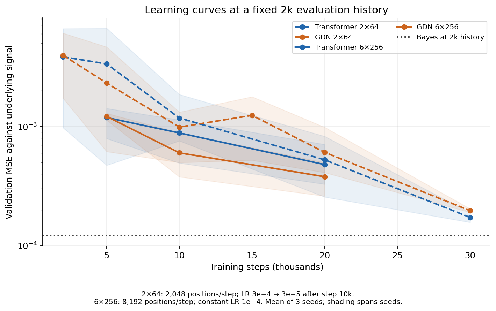
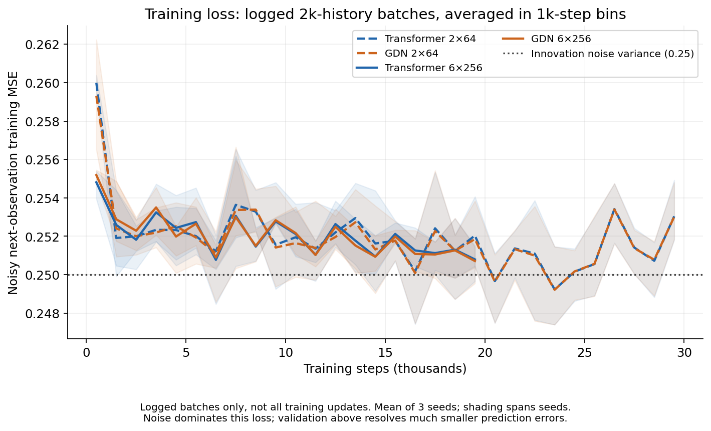
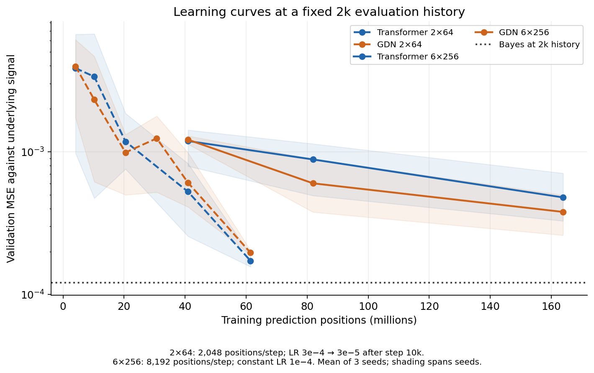

# Saved learning curves: 2×64 versus 6×256

These comparisons use the main three seeds, not the single-seed high-LR sensitivity arms. The small models use cosine decay after 10k steps; the larger models use constant LR. Width, implementation, precision and batch size also differ. This is not a depth-only comparison. Training plots use only logged 2k-history batches and 1k-step averaging. Validation plots show the same 512 evaluation series and a fixed 2k history. Source paths/hashes and exact points are in `summary.json` and `validation_points.csv`.
