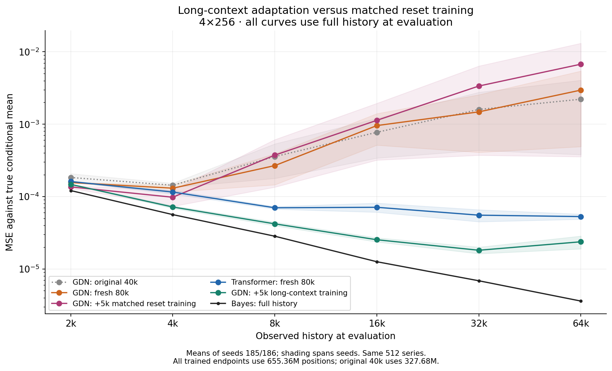
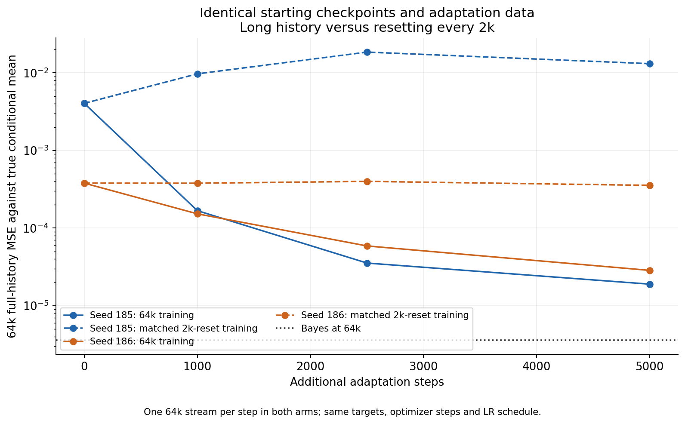
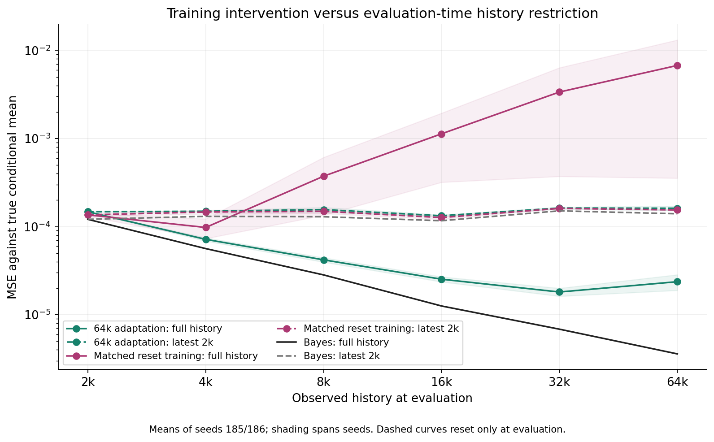
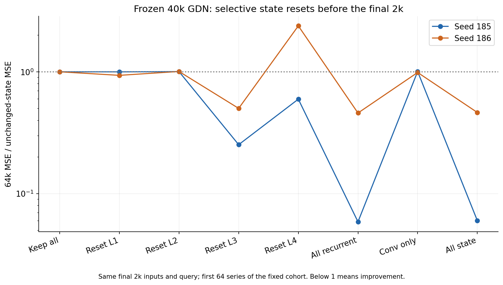

# Long-context adaptation versus matched reset training

All ten jobs in `alex_261124_next_205830` finished successfully: eight training jobs and two frozen-checkpoint layer ablations. All 24 saved training-checkpoint evaluations completed on 512 validation series through 64k history. Four local monitor records initially reported connection timeouts; their actual completed returns were recovered from personal Modal and reconciled. These were monitoring failures, not training failures. No GPU containers remained active when checked. Estimated allocated worker compute: $17.76 (not a billing receipt).

## Main comparison

All curves use full history at evaluation. Means and shaded min–max ranges use the same two model seeds, 185 and 186. The original 40k parent reference has been recomputed over these two seeds rather than reusing the prior three-seed average. Shading is not a confidence interval.

| Training | 2k full MSE | 64k full MSE | 64k latest-2k MSE |
|---|---:|---:|---:|
| GDN: original 40k | 0.000183329 | 0.00221458 | 0.000199355 |
| GDN: fresh 80k | 0.000156146 | 0.00295927 | 0.00018316 |
| GDN: +5k matched reset training | 0.000136006 | 0.00674963 | 0.00015461 |
| Transformer: fresh 80k | 0.000161319 | 5.28403e-05 | 0.000201259 |
| GDN: +5k long-context training | 0.000147383 | 2.36956e-05 | 0.000161585 |
| Bayes | 0.000120979 | 0.00000359153 | 0.000139877 |

Error is MSE against the true conditional mean a*y[t], not noisy-target MSE or Bayes-normalized excess. Training uses noisy future targets.

## Paired adaptation experiment

Each pair starts from the identical 40k GDN checkpoint and Adam state. Both arms receive identical 64k streams, observed transition tokens and targets, with the same LR schedule and one optimizer step per stream. The long-context arm backpropagates through the full stream. The reset control splits the same tokens into 32 fresh-state chunks of 2k and accumulates their equally weighted gradients before one optimizer step. Thus both history access and gradient horizon change; they have not been isolated from each other.

| Seed | Original 40k, 64k MSE | +5k full-64k adaptation | +5k matched reset training | Reset / long error |
|---|---:|---:|---:|---:|
| 185 | 0.00404986 | 1.89222e-05 | 0.0131442 | 694.6× |
| 186 | 0.000379301 | 2.84689e-05 | 0.000355093 | 12.5× |

Long-context adaptation reduces the parent checkpoints’ 64k errors by 214× and 13.3×. It beats the matched reset control by approximately 695× and 12.5×. The large seed variability must remain visible. The reset control has better 2k accuracy than long-context adaptation in both seeds; its poor long-history performance is not simply worse accuracy everywhere.

## Evaluation-time restriction after adaptation

After long-context adaptation, full history beats latest-2k replay. After reset-control training, latest-2k replay still substantially improves accuracy. This reverses the history-policy preference through a training intervention.

## Stronger fresh baselines

Fresh 80k GDN still deteriorates at long histories in both seeds. Its 64k error is higher than the matching 40k parent at both seeds, despite improved 2k accuracy. The fresh 40k and 80k runs use schedules with different horizons; this is a training-budget comparison, not an isolated causal effect of extra steps.

The long-adapted GDN has lower 64k error than the fresh 80k Transformer in both seeds. All final trained endpoints have 655.36M lifetime prediction positions, but sequence-length distributions, optimizer-step counts, architecture parameter counts and compute differ. This does not establish architecture superiority under identical training. Also, 64k is within the adaptation training length; this experiment demonstrates repair at the tested lengths, not extrapolation beyond the new horizon.

## Layer resets

On the original frozen 40k GDN checkpoints, resetting only recurrent layer 3 before replaying the final 2k reduces 64k error by 74.8% and 49.9%. Resetting all recurrent memories reduces it by 94.1% and 54.1%. Convolution-cache-only reset has little effect; layer-4 reset has opposite effects across the two seeds. These interventions identify where a useful reset can act, not a proven mechanistic explanation of how harmful states arise. The cohort is the first 64 of the same 512 validation series.

## Verification and scope

All source hashes, saved prediction metrics, shared validation series and full/window equality at 2k were checked. The all-state-reset and fresh-suffix ablation predictions match exactly. The 24 checkpoint evaluations have finite predictions and match their stored metrics; training-time quick validation agrees with the corresponding 2k checkpoint evaluation. See `verification.json`.

Only two paired training seeds; fixed synthetic AR(1) prior, matched train/eval generative parameters, repeatedly inspected validation cohort, no independent confirmation. No convergence, universal recurrent-model limitation, or real-world forecasting claim is established. Paired series-bootstrap intervals in `adaptation_paired.csv` are conditional on the trained models, not population uncertainty over training seeds.

## Files

- `long_history_comparison.pdf`, `adaptation_by_seed.pdf`, `adaptation_eval_policies.pdf`, `layer_reset_64k.pdf`: vector figures for the report. PNG equivalents are included.
- `metrics.csv`: per-seed/per-checkpoint/per-history results; filter final fresh step 80000 or final adaptation step 5000.
- `final_comparisons.csv`, `adaptation_paired.csv`, `layer_ablation.csv`, `quick_validation.csv`, `summary.json`: measurements and aggregates.
- `resolved_plan.json`: exact launch configurations; `cloud_call_verification.json`: recovered cloud completion checks.
- `raw/`: source snapshots, manifests, prediction arrays, references and logs for this batch. `parents/`: matching original 40k prediction/reference records.
- Rebuild with `scripts/summarize_forecast_next.py` after fetching the batch artifacts. Full checkpoints remain on personal Modal.
