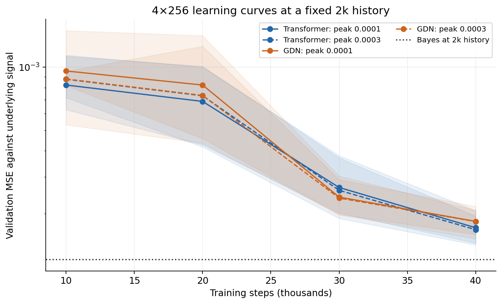
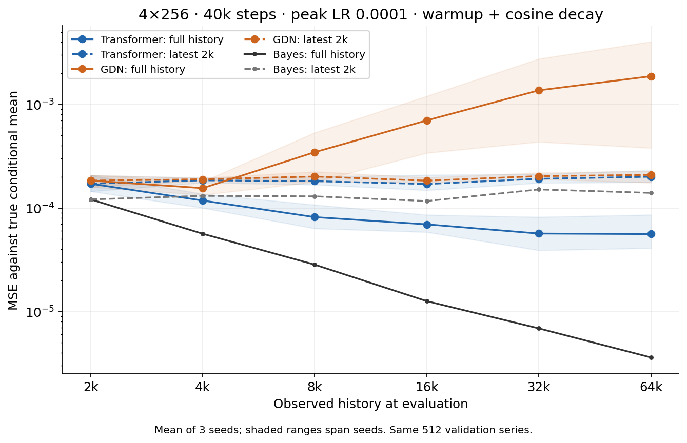
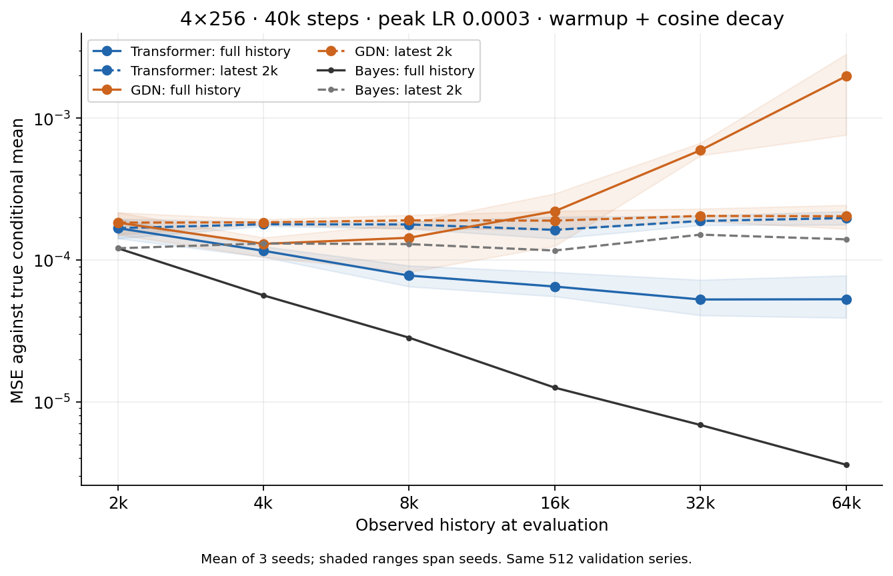

# 40k-step reference-model results

All 12 approved runs completed: two architectures × two peak learning rates × three fresh seeds. Each model has 4 layers and width 256. All 36 checkpoint evaluations completed through 64k history. The batch took about 35 minutes; estimated allocated worker compute was $18.61, excluding startup/teardown and other billing overhead. No retries were needed. All personal Modal containers were stopped when checked.

## Main finding

After warmup and cosine decay, both architectures reach similar short-history accuracy. Nevertheless, all six GDN runs perform worse with full 64k history than with only the latest 2k; all six Transformers show the opposite ordering. This is reproducible within this synthetic AR(1) setup, these implementations and these hyperparameters.

## Final metrics

All table values are MSE against the true conditional mean, multiplied by 10,000. Each row averages three model seeds on the same 512 validation series. Lower is better.

| Model | Peak LR | 2k history | 64k full | 64k latest 2k |
|---|---:|---:|---:|---:|
| Transformer | 0.0001 | 1.714 | 0.559 | 2.003 |
| Transformer | 0.0003 | 1.678 | 0.528 | 1.976 |
| GDN | 0.0001 | 1.837 | 18.741 | 2.086 |
| GDN | 0.0003 | 1.835 | 19.782 | 2.036 |
| Bayes | — | 1.210 | 0.0359 | 1.399 |

At 64k, restricting GDN to the latest 2k reduces mean error by 88.9% at peak LR 1e-4 and 89.7% at 3e-4. Across individual runs the reduction ranges from 54% to 94.5%. The corresponding Transformer gains from full history are 72.1% and 73.3% relative to its latest-2k baseline.

## What additional training changed

Between 20k and 40k, mean 2k validation error fell roughly fourfold in every model/LR group. This measures the combined effect of continued training and the progressing LR schedule; it does not isolate decay from additional steps.

| Model | Peak LR | 20k-step error at 2k | 40k-step error at 2k | 20k-step error at 64k | 40k-step error at 64k |
|---|---:|---:|---:|---:|---:|
| Transformer | 0.0001 | 6.868 | 1.714 | 5.408 | 0.559 |
| Transformer | 0.0003 | 7.310 | 1.678 | 6.825 | 0.528 |
| GDN | 0.0001 | 8.223 | 1.837 | 9.259 | 18.741 |
| GDN | 0.0003 | 7.335 | 1.835 | 21.319 | 19.782 |

For GDN at peak LR 1e-4, long-history error actually increased from 20k to 40k while short-history error improved. At 3e-4, long-history error improved only slightly. Thus this extra training did not remove the failure. It does not establish that further training or different training distributions could never fix it.

## Protocol and scope

- HF Llama-block NoPE Transformer: 3,411,201 parameters. FLA Gated DeltaNet: 4,484,897 parameters. Both use 4 layers, width 256, 4 heads, SwiGLU intermediate width 768. Parameter counts are not exactly matched.
- Seeds 185/186/187 and peak LRs 1e-4/3e-4, independently crossed. Adam, no weight decay, gradient clipping 1.0. Linear warmup over 1,000 steps from 10% of peak, followed by cosine decay to 10% by step 40,000.
- 8,192 prediction positions per step: 327.68M per run and 3.93216B across the batch. Training alternates 64- and 2,048-position histories, with fresh streams each step.
- AR(1): y[t+1] = a*y[t] + noise; a is uniform on [-0.95,0.95] and fixed within each stream, Gaussian innovation standard deviation 0.5, y[0]=0. Tokens contain observed transitions. Training targets are noisy future observations; evaluation removes irreducible target noise by comparing predictions with a*y[t].
- Full-history and fresh-state latest-2k inference use the same checkpoint and fixed query. There is no test-time weight update. Evaluation uses 512 fixed validation series at origins 2k, 4k, 8k, 16k, 32k and 64k. The separately reserved confirmation set remains unopened.
- BF16 backbone execution, FP32 parameters/optimizer and readout/loss. Limited FP32 diagnostics used four series at 2k and 16k for seed 185 at peak 1e-4. BF16–FP32 prediction MSE at 16k was 1.13e-6 for Transformer and 1.47e-6 for GDN; this is not a full 64k numerical-precision audit.
- Learning curves and long-history figures show three-seed means with min–max seed ranges, not confidence intervals. Paired series-bootstrap intervals in the CSV are conditional on the three trained models; they are not population uncertainty over training seeds.

## Claims to avoid

These runs do not establish convergence, a universal recurrent-model limitation, a memory-capacity cause, a real-world forecasting result, or a precision-independent mechanism. The evaluated task has a finite sufficient-statistic solution, so failure is not proof that fixed state is intrinsically insufficient. Earlier 2×64/6×256 runs differ in multiple settings and cannot isolate depth. The validation set has been used repeatedly; independent confirmation is still outstanding.

## Reproducibility

`resolved_plan.json` contains the complete launch plan. `raw/` contains saved predictions, exact source snapshots, configurations, manifests, training logs and precision checks. `metrics.csv`, `quick_validation.csv`, `paired_comparisons.csv` and `summary.json` contain measurements. `verification.json` records checks of all 12 schedules, source hashes, finite predictions/losses/gradient norms, identical validation streams, recomputed metrics, and equality of full/window predictions at 2k. Checkpoints remain in the personal Modal volume under the batch run names.

Rebuild figures with `scripts/summarize_forecast_40k.py` from the fetched artifacts. No new GPU computation is needed.
