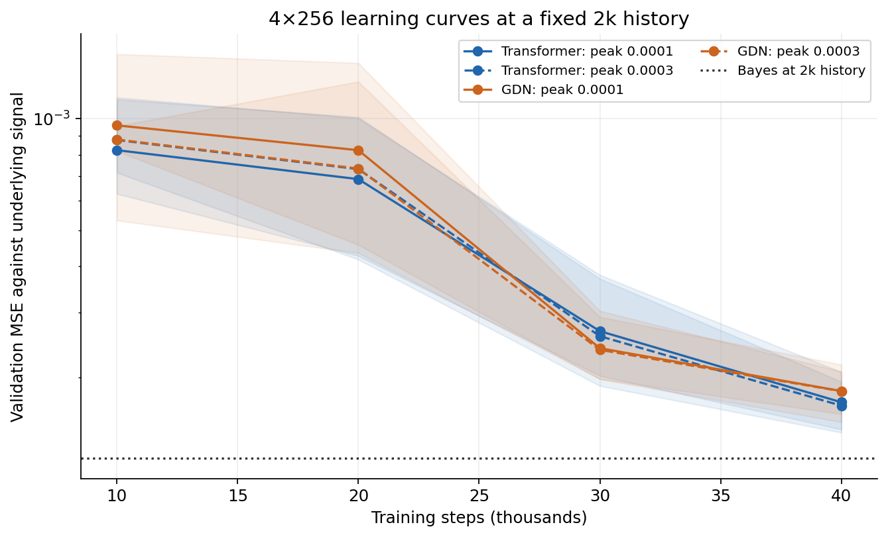
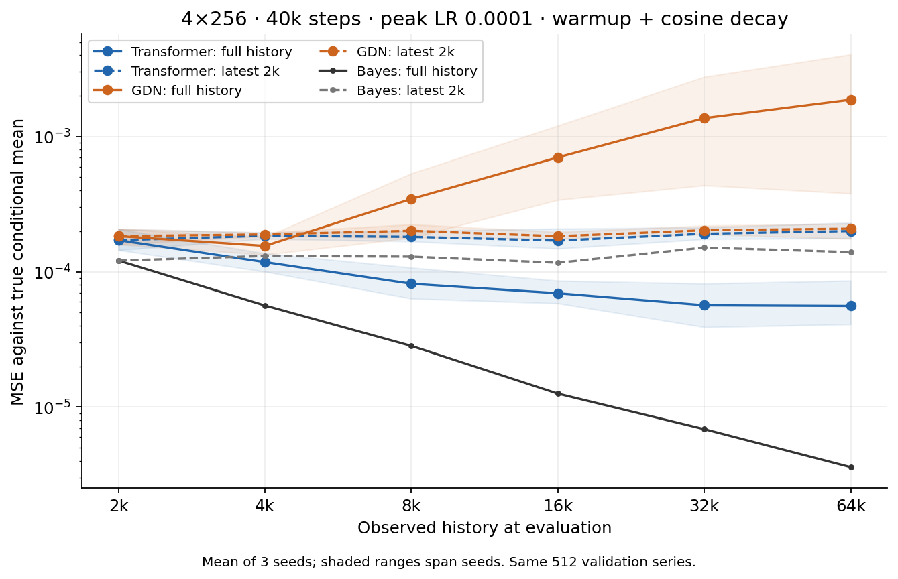
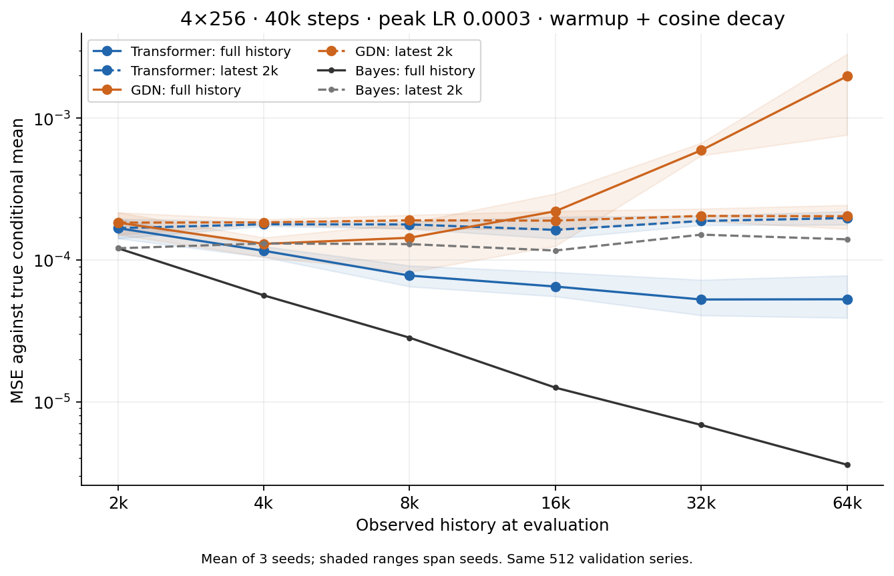

# 4×256, 40k-step warmup/cosine sweep

12 runs: Transformer and GDN, peak LRs 1e-4 and 3e-4, seeds 185/186/187. Fresh training, 1k linear warmup from 10% of peak, cosine decay to 10% of peak. 327.68M positions/run, alternating 64/2k training histories.

Metrics use the same 512 validation series at fixed origins. No confirmation-set access. Mean curves aggregate three seeds; shading spans seeds. All individual predictions, sources and manifests are in `raw/`. `summary.json` records completion and numerical checks. Checkpoints remain on the personal Modal volume.

Neither 40k steps nor a declining loss establishes convergence. Comparison against earlier 2×64 and 6×256 runs changes multiple settings and is not a depth-only ablation.
