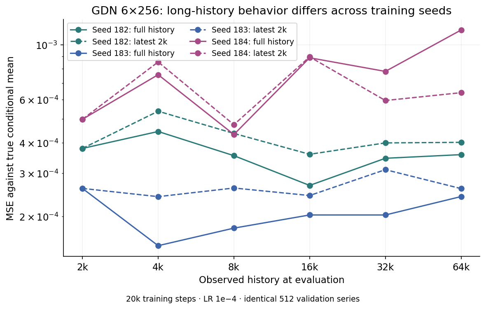
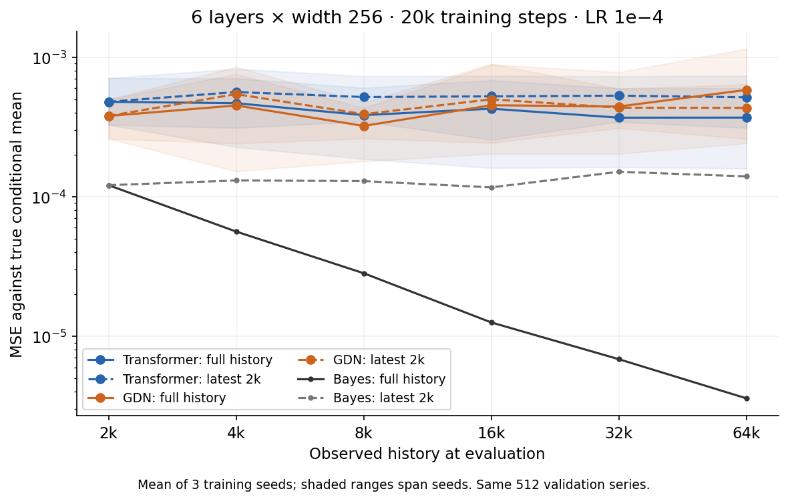

# What the 6×256 runs show

All eight runs completed 20,000 training steps, and all 24 checkpoint evaluations
(5k/10k/20k) completed through 65,536 observations. No retries were needed. The
personal Modal container inventory was empty after completion. Estimated worker
compute is $9.87 at the launch-plan rates, excluding startup/teardown overhead;
this is an estimate, not a billing receipt. The entire batch took about 27 minutes
from worker start, with training taking 6.3–6.5 minutes for Transformers and
14.2–20.0 minutes for GDN, including first-step compilation.

## The aggregate result hides a seed-dependent GDN failure

At 64k history, MSE against the true next-value conditional mean:

| Model / seed, LR 1e-4 | Full history | Latest 2k | Effect of resetting |
|---|---:|---:|---|
| Transformer, mean of 3 seeds | 3.689e-4 | 5.161e-4 | Worse in all 3 seeds |
| GDN, seed 182 | 3.574e-4 | 4.011e-4 | Mean error increases 12.2% |
| GDN, seed 183 | 2.412e-4 | 2.599e-4 | Mean error increases 7.8% |
| GDN, seed 184 | 1.151e-3 | 6.392e-4 | Mean error decreases 44.4% |
| GDN, mean of 3 seeds | 5.830e-4 | 4.334e-4 | Mean error decreases 25.7% |
| Full-history Bayes | 3.592e-6 | — | — |

The original latest-2k benefit survives in one of the three primary GDN seeds,
but not as a consistent across-seed result. The other two have lower mean error
with full history; their individual 64k differences are modest. The aggregate
reset advantage is driven by seed 184. In that seed, full-history error at 64k is
2.31 times its 2k error. The other two finish slightly below their 2k errors,
although their curves are not monotonically improving with history.

The mean paired 64k window-minus-full differences are +1.472e-4 for Transformer
and -1.496e-4 for GDN. Their pointwise 95% paired-series bootstrap intervals are
[1.032e-4, 1.951e-4] and [-2.150e-4, -8.936e-5], respectively. These intervals
condition on the three trained models; they do **not** establish robustness over
the population of training seeds.

## Learning rate changes extrapolation without changing the architecture

For GDN seed 182, increasing LR from 1e-4 to 3e-4 changes 2k error from
3.789e-4 to 3.648e-4 (similar short-history accuracy), but increases 64k
full-history error from 3.574e-4 to 5.837e-4, a 63.3% increase. At the higher LR,
resetting to the latest 2k reduces error to 3.727e-4, a 36.1% reduction.

This is one predeclared, single-seed sensitivity check. It motivates investigating
how training choices affect long-history behavior; it does not establish a
universal learning-rate rule or isolate an internal mechanism.

## What we can claim

The larger reference GDN can still show harmful accumulation beyond its training
history, and replaying a short window can mitigate that failure. Whether this
happens depends on the learned model: initialization/data seed and the LR
sensitivity arm produce different outcomes with the same architecture. A claim
that GDN always degrades with longer history would be too strong.

The new Transformer benefits consistently from full history, but its absolute
64k error is about six times the earlier small Transformer's error on the same
validation series. Neither parameter count nor training-token count alone has
given us a stronger baseline here. Several checkpoint curves are still improving
or nonmonotonic; 20k steps must be described as a fixed budget, not convergence.

The reference implementation, depth, width, state size, numerical precision,
batch size, schedule and training budget differ from the old experiment. This is
not a depth-only ablation, so we cannot attribute the changed behavior to depth.
The task remains synthetic scalar AR(1), not a time-series foundation-model
benchmark. Both models remain far above the full-history Bayes error at 64k.

## Numerical and provenance checks

All saved predictions are finite, all models use identical validation series,
and full/window predictions are identical at the 2k origin. Window Bayes inference
includes the first visible observation's coefficient-dependent density and was
checked using 512/1024-node quadrature. Cross-worker reference differences were
below 1e-12; training data and latent targets match exactly.

On four series at 2k and 16k, BF16-versus-FP32 prediction-disagreement MSE ranged
from 2.28e-7 to 3.06e-7 for Transformer and 1.34e-7 to 5.80e-7 for GDN. These are
small relative to the reported forecasting errors on those checks, but they do
not validate the 64k numerical error floor or every seed. No confirmation-set
examples were opened.

`metrics.csv`, `paired_comparisons.csv`, `comparison_to_legacy.csv`, `summary.json`
and `verification.json` contain the numerical results. `raw/` contains per-series
predictions, source snapshots, configs and manifests. Full model checkpoints
remain in the personal Modal volume, with hashes recorded in the manifests.
