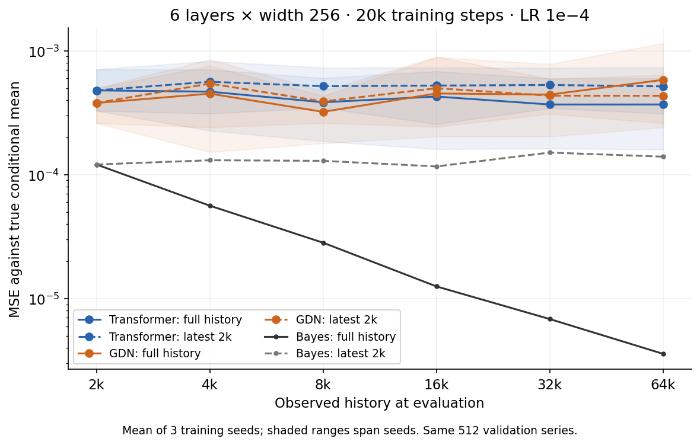

# Reference 6×256 forecasting experiment

Read [the findings and limitations](FINDINGS.md) for the interpretation and per-seed results.

Eight approved runs: three seeds per architecture at LR 1e-4 and one seed per architecture at LR 3e-4. 20k training steps; 163.84M prediction positions per run. See `summary.json` for completion and numerical-check status.

Full history and fresh-state latest-2k predictions use identical query origins on 512 validation series. Bayes window inference includes the likelihood of the initial visible observation. Shading spans training seeds. Paired intervals in `paired_comparisons.csv` resample series conditional on these models.

Raw source snapshots, manifests, training curves and per-series predictions are under `raw/`. Checkpoints remain on the personal Modal volume; source hashes and checkpoint hashes are in the manifests. No confirmation-set access.

This is a fixed-budget synthetic-task result, not proof of convergence or a claim about foundation-model scale. Numerical precision checks cover only four series at 2k/16k.
